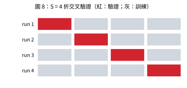

# 交叉驗證 (Cross-Validation)

## 1. 問題設定

📌講義：要建立好模型，應盡量把資料用於訓練；但驗證集若太小，對預測效能的估計會相當雜亂。解決此兩難的一個方法是**交叉驗證 (cross-validation)**。(來源: [[ch01-deep-learning-revolution]], p.11)

## 2. 步驟

📌講義：把資料分成 $S$ 組等大的群組，取其中 $S-1$ 組訓練、剩下 1 組評估，對 $S$ 種留出方式各做一次，再將 $S$ 次的效能分數平均。如此可用 $(S-1)/S$ 比例的資料訓練，同時所有資料都被用於評估。資料特別稀少時，可取 $S=N$，即**留一法 (leave-one-out)**。(來源: [[ch01-deep-learning-revolution]], p.11)

```text
輸入: 資料 D（N 筆）、折數 S、候選超參數集合 H
1. 將 D 隨機分成 S 組 D_1..D_S（大小相同）
2. 對每個 h in H:
     對 k = 1..S:
        用 D \ D_k 訓練模型（超參數 h）
        在 D_k 上計算誤差 e_k(h)
     CV(h) = mean_k e_k(h)
3. 選 h* = argmin_h CV(h)
4. 以 h* 在「全部資料（或訓練集）」重新訓練；最終效能留給獨立測試集
```



## 3. 優缺點

📌講義：主要缺點是訓練次數增加 $S$ 倍，對本身就很昂貴的模型會成問題。另一個問題：模型可能有多個複雜度超參數（如多個正則化係數），探索其組合最壞情況下所需訓練次數會隨超參數個數呈指數成長。現代最先進模型極其龐大，探索超參數空間有限，多半仰賴小模型上的經驗與啟發式法則。(來源: [[ch01-deep-learning-revolution]], p.11)

## 4. 習題 7 解答與推導（對應：第一章習題 7）

📌講義：習題 7（⋆交叉驗證的計算成本）：(a) $S$ 折交叉驗證需要幾次訓練？留一法呢？(b) 對線性模型，證明留一法的殘差可由一次完整最小平方解得到：令帽子矩陣 $H=\Phi(\Phi^T\Phi)^{-1}\Phi^T$，則 $t_n-y^{(-n)}(x_n)=\dfrac{t_n-y(x_n,\mathbf w^\star)}{1-H_{nn}}$，其中 $y^{(-n)}$ 為去掉第 $n$ 點後的擬合（提示：Sherman–Morrison 公式）；(c) 若模型有 $K$ 個超參數、每個嘗試 $G$ 個值，格點搜尋加 $S$ 折交叉驗證共需幾次訓練？(來源: [[ch01-deep-learning-revolution]], p.17)

**以下解答皆為 💡補充：**

**(a)** $S$ 折需 $S$ 次訓練（每折訓練一次）；留一法 $S=N$，需 $N$ 次訓練。

**(b)** 記 $A=\Phi^T\Phi$，第 $n$ 列為 $\boldsymbol\phi_n^T$，$h=H_{nn}=\boldsymbol\phi_n^TA^{-1}\boldsymbol\phi_n$，$\hat y_n=\boldsymbol\phi_n^T\mathbf w^\star$。去掉第 $n$ 點後：
$A_{-n}=A-\boldsymbol\phi_n\boldsymbol\phi_n^T$，$\Phi_{-n}^T\mathbf t_{-n}=\Phi^T\mathbf t-\boldsymbol\phi_nt_n$。
Sherman–Morrison：
$$A_{-n}^{-1}=A^{-1}+\frac{A^{-1}\boldsymbol\phi_n\boldsymbol\phi_n^TA^{-1}}{1-h}.$$
則 $\mathbf w_{-n}=A_{-n}^{-1}(\Phi^T\mathbf t-\boldsymbol\phi_nt_n)$。展開並使用 $A^{-1}\Phi^T\mathbf t=\mathbf w^\star$：
$$\mathbf w_{-n}=\mathbf w^\star-A^{-1}\boldsymbol\phi_nt_n+\frac{A^{-1}\boldsymbol\phi_n\hat y_n}{1-h}-\frac{h\,A^{-1}\boldsymbol\phi_nt_n}{1-h}
=\mathbf w^\star+A^{-1}\boldsymbol\phi_n\,\frac{\hat y_n-t_n}{1-h}.$$
（最後一步：$-t_n-\frac{h t_n}{1-h}=-\frac{t_n}{1-h}$。）於是被去掉點的預測為
$$y^{(-n)}(x_n)=\boldsymbol\phi_n^T\mathbf w_{-n}=\hat y_n+h\,\frac{\hat y_n-t_n}{1-h}=\frac{\hat y_n-h\,t_n}{1-h},$$
$$t_n-y^{(-n)}(x_n)=\frac{t_n(1-h)-\hat y_n+h\,t_n}{1-h}=\frac{t_n-\hat y_n}{1-H_{nn}}.\quad\blacksquare$$
意義：對線性模型只需**一次**完整訓練，即可得到全部 $N$ 個留一殘差，留一法的成本由 $N$ 次訓練降為 1 次。

**(c)** 格點共 $G^K$ 組超參數，每組做 $S$ 折，共 $S\cdot G^K$ 次訓練（若再以最佳組合對全資料重訓一次則 $+1$）；隨 $K$ 呈指數成長，呼應講義所述缺點。

## 5. NumPy 實作

💡補充：以 $S$ 折交叉驗證選多項式階數 $M$，並驗證習題 7(b) 的留一法捷徑（已實際執行）。

```python
import numpy as np


def make_data(n, rng, sigma=0.3):
    x = rng.uniform(0.0, 1.0, n)
    return x, np.sin(2 * np.pi * x) + rng.normal(0.0, sigma, n)


def poly(x, M):
    return np.vander(x, M + 1, increasing=True)


def fit(Phi, t):
    return np.linalg.lstsq(Phi, t, rcond=None)[0]


def s_fold_cv(x, t, M, S, rng):
    """S 折交叉驗證的平均 RMS 誤差。"""
    idx = rng.permutation(len(x))
    folds = np.array_split(idx, S)
    errs = []
    for k in range(S):
        val = folds[k]
        tr = np.concatenate([folds[j] for j in range(S) if j != k])
        w = fit(poly(x[tr], M), t[tr])
        errs.append(np.mean((poly(x[val], M) @ w - t[val]) ** 2))
    return float(np.sqrt(np.mean(errs)))


rng = np.random.default_rng(0)
x, t = make_data(30, rng)
print("M  5折CV  留一法(S=N)")
for M in range(0, 9):
    print(f"{M}  {s_fold_cv(x, t, M, 5, np.random.default_rng(1)):.3f}   {s_fold_cv(x, t, M, len(x), np.random.default_rng(1)):.3f}")

# 習題 7(b)：留一殘差 = (t_n - y_n) / (1 - H_nn)，只需一次完整擬合
M = 3
Phi = poly(x, M)
w = fit(Phi, t)
H = Phi @ np.linalg.inv(Phi.T @ Phi) @ Phi.T
fast = (t - Phi @ w) / (1 - np.diag(H))
slow = np.empty(len(x))
for n in range(len(x)):
    keep = np.arange(len(x)) != n
    slow[n] = t[n] - Phi[n] @ fit(Phi[keep], t[keep])
print("\n捷徑公式與逐點重訓一致:", np.allclose(fast, slow))
print("LOO-CV RMS =", np.sqrt(np.mean(fast**2)))

# 習題 7(c)：訓練次數
S, K, G = 5, 3, 10
print(f"S={S}, K={K}, G={G}: 格點搜尋 + CV 共 {S * G**K} 次訓練")
```

## 自我測驗 Q&A

> [!question] Q1. $S$ 折交叉驗證相較於單一驗證集的優點是什麼？
> [!answer]- 答案
> 每次可用 $(S-1)/S$ 的資料訓練，同時所有資料都輪流用於評估，對效能的估計比單一小驗證集穩定。(來源: [[ch01-deep-learning-revolution]], p.11)

> [!question] Q2. 交叉驗證的主要代價是什麼？
> [!answer]- 答案
> 訓練次數增加 $S$ 倍；若有多個超參數，格點搜尋的訓練次數隨超參數個數指數成長。(來源: [[ch01-deep-learning-revolution]], p.11)

> [!question] Q3. 留一法是 $S$ 取何值？何時使用？
> [!answer]- 答案
> $S=N$；資料特別稀少時使用。(來源: [[ch01-deep-learning-revolution]], p.11)

> [!question] Q4. 對線性最小平方模型，留一法需要重訓 $N$ 次嗎？
> [!answer]- 答案
> 💡補充：不需要。利用帽子矩陣，$t_n-y^{(-n)}(x_n)=(t_n-\hat y_n)/(1-H_{nn})$，一次完整擬合即可（習題 7(b)）。

> [!question] Q5. 有 $K=4$ 個超參數，每個試 $G=5$ 個值，5 折 CV 要訓練幾次？
> [!answer]- 答案
> 💡補充：$S\cdot G^K=5\times5^4=3125$ 次。

## 相關頁面

[[hyperparameters-model-selection]] · [[generalization-overfitting]] · [[least-squares-normal-equations]] · [[regularization-weight-decay]]
