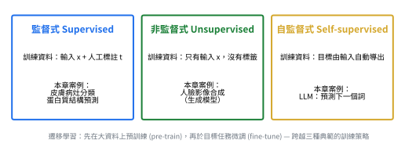

# 監督式 vs 非監督式 vs 自監督式學習 (Supervised vs Unsupervised vs Self-supervised Learning)

## 1. 講義的三種典範對照

📌講義：

| 典範 | 訓練資料的形式 | 本章案例 |
|---|---|---|
| 監督式 | 輸入 + 人工標註的目標 | 皮膚病灶分類、蛋白質結構預測 |
| 非監督式 | 只有輸入，無標籤 | 人臉影像合成（生成模型） |
| 自監督式 | 目標從輸入自動導出 | LLM 的「預測下一個詞」 |

遷移學習則是跨越典範的訓練策略：先在大資料上預訓練，再於目標任務上微調。(來源: [[ch01-deep-learning-revolution]], p.4)

## 2. 延伸比較（💡補充）

以下欄位為 agent 整理，講義僅明示上表三欄；「數學形式」與「評估方式」為標準教材說法。

| 面向 | 監督式 | 非監督式 | 自監督式 |
|---|---|---|---|
| 資料 | $\{(x_n,t_n)\}$ | $\{x_n\}$ | $\{x_n\}$（再自行切出 $(x',t')$） |
| 標籤來源 | 人工標註／實驗真值（如切片檢查、已測得的蛋白質結構） | 無 | 由資料自己產生（下一個詞、被遮住的部分、未來的值） |
| 數學形式（示意） | $\min_{\mathbf w}\sum_nL(f(x_n;\mathbf w),t_n)$ | 學習 $p(x)$ 的結構（分群、密度、生成） | $\min_{\mathbf w}\sum_nL(f(x'_n;\mathbf w),g(x_n))$，$g$ 為自動構造目標 |
| 典型任務 | 分類、迴歸 | 分群、生成、降維 | 預測下一個詞、時間序列預測 |
| 規模化瓶頸 | 標註成本 | 評估困難 | 幾乎沒有標註瓶頸，可擴展到極大資料 |
| 本章案例 | 皮膚病灶、AlphaFold | 人臉合成 | LLM |
| 本 wiki 範例 | [[learning-paradigms]] 程式 §1 | [[learning-paradigms]] 程式 §2a/2b | [[learning-paradigms]] 程式 §3、§4 |

📌講義：自監督式「雖然學的是輸入→輸出的函數，但標籤是自動從輸入資料取得，無須額外的人工標註」，因此能擴展到極大的訓練集與極大的神經網路。(來源: [[ch01-deep-learning-revolution]], p.4)

## 3. 另一個維度：分類 vs 迴歸

📌講義：分類：輸出屬於離散的類別集合（如良性／惡性）；迴歸：輸出為一個或多個連續變數（如化工製程產率）。(來源: [[ch01-deep-learning-revolution]], p.3)

| | 離散輸出 | 連續輸出 |
|---|---|---|
| **監督式** | 分類：皮膚病灶（良性／惡性） | 迴歸：製程產率、VTEC 預測、多項式曲線擬合 |
| **自監督式** | 預測下一個詞（從詞彙表中選一個離散詞） | 預測下一時刻的數值（習題 1(a)(d)） |
| **非監督式** | （分群：群編號） | 生成連續值的影像、密度估計 |

（表格組織為 💡補充；各格案例取自講義 p.3–4 與習題 1。）

## 4. 如何判斷？（💡補充）

1. 有沒有**需要人工提供的**目標值？有 → 監督式。
2. 目標值是不是**從輸入資料自己切出來**的（如序列的下一個元素）？是 → 自監督式。
3. 完全沒有目標值，只想理解／生成資料？是 → 非監督式。

習題 1 的逐題判斷見 [[learning-paradigms]]。

## 相關頁面

[[learning-paradigms]] · [[transfer-learning]] · [[polynomial-curve-fitting]] · [[scaling-and-representation-learning]]
