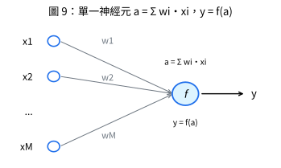
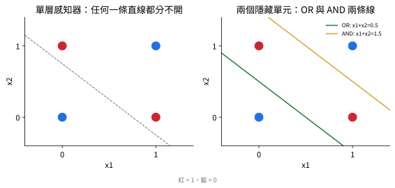

# 人工神經元與感知器 (Artificial Neuron and Perceptron)

## 1. 從生物神經元到數學模型

📌講義：神經網路模型最初受人類與其他哺乳動物大腦資訊處理的研究啟發。基本處理單元是**神經元 (neuron)**：「放電」時沿**軸突 (axon)** 送出電脈衝，抵達**突觸 (synapse)** 與其他神經元相連；突觸釋放的神經傳導物質可刺激或抑制後續神經元。人腦約有 900 億個神經元，每個平均有數千個突觸，整體約 $10^{14}$ 個突觸；突觸強度的改變是大腦儲存資訊、從經驗學習的關鍵機制。(來源: [[ch01-deep-learning-revolution]], p.12)

📌講義：人工神經網路 (McCulloch and Pitts, 1943) 捕捉這些性質。多數模型以「其他神經元輸出的線性組合，再經一個非線性函數轉換」描述單一神經元：

$$a=\sum_{i=1}^Mw_ix_i,\tag{5}\qquad y=f(a)\tag{6}$$

$x_i$ 為輸入，$w_i$ 為**權重 (weights)**（對應突觸強度），$a$ 稱**前激活 (pre-activation)**，$f(\cdot)$ 稱**激活函數 (activation function)**，輸出 $y$ 稱**激活 (activation)**。此簡單形式自 1960 年代至今一直是神經網路模型的基礎。(來源: [[ch01-deep-learning-revolution]], p.12)



## 2. 多項式其實就是一個「神經元」

📌講義：把式 (1) 與 (5)–(6) 對照：令輸入 $x_i$ 為單一變數 $x$ 的各次冪（$x^0=1,x^1=x,x^2,\dots$），激活函數取恆等 $f(a)=a$，多項式模型就是圖 9 的一個實例。(來源: [[ch01-deep-learning-revolution]], p.12)　（講義教學補充）

## 3. 感知器 (Perceptron)

📌講義：由 (5)–(6) 描述的簡單神經模型可視為只有單層處理。其中最重要者是**感知器** (Rosenblatt, 1962)，激活函數為階梯函數：

$$f(a)=\begin{cases}0,&a\le0\\1,&a>0\end{cases}\tag{7}$$

可視為神經放電的簡化模型：若且唯若加權輸入總和超過閾值 0 時才放電。Rosenblatt 提出專門的訓練演算法，有一個有趣性質：若存在一組權重使感知器能完美分類其訓練資料，則此演算法**保證在有限步內找到解**。(來源: [[ch01-deep-learning-revolution]], p.13)

📌講義：感知器有專屬的類比硬體實作（Mark 1 感知器）：輸入來自簡單攝影系統，將印刷字元投影到 $20\times20$ 的硫化鎘光電池陣列（400 像素影像）；每個權重以馬達驅動的可變電阻實作，使學習演算法能自動調整權重。典型感知器雖有多層處理，但只有一層可從資料學習，故被視為「單層」網路。(來源: [[ch01-deep-learning-revolution]], p.13)

📌講義：Minsky 與 Papert (1969) 對單層網路能力的限制給出形式證明，並臆測類似限制延伸到多層可學習參數的網路——後者後來證明大錯特錯，但當時澆熄了對神經網路的熱情，導致 1970 年代至 1980 年代初的興趣與經費付之闕如；且當時缺乏訓練多層網路的有效演算法（感知器演算法只適用於單層模型）。感知器雖已從實用機器學習消失，名稱仍留存：現代神經網路有時也稱**多層感知器 (multilayer perceptron, MLP)**。(來源: [[ch01-deep-learning-revolution]], p.13)　歷史脈絡見 [[history-of-neural-networks]]。

## 4. 感知器的限制：XOR 問題（講義教學補充）

📌講義（講義教學補充）：單層感知器只能實現線性可分的決策邊界（輸入空間中的超平面 $\mathbf w^T\mathbf x=0$）。經典反例是 XOR：四個點 $(0,0)\mapsto0$、$(1,1)\mapsto0$、$(0,1)\mapsto1$、$(1,0)\mapsto1$ 無法以任何一條直線分開（習題 9）。加入一層隱藏單元後即可解決——這正是多層網路價值所在，也是 Minsky–Papert 臆測失準之處。(來源: [[ch01-deep-learning-revolution]], p.13)



## 5. 習題 8、習題 9 解答（對應：第一章習題 8、9）

📌講義：習題 8（⋆多項式是神經元的特例）：(a) 明確寫出使 (5)–(6) 退化為 (1) 的 $x_i,w_i,f$；(b) 若改取 $f(a)=\tanh(a)$，模型 $y=\tanh(\sum_jw_jx^j)$ 仍是 $\mathbf w$ 的線性函數嗎？平方和誤差仍是 $\mathbf w$ 的二次函數嗎？這對「閉式解」有何影響？(來源: [[ch01-deep-learning-revolution]], p.17)

📌講義：習題 9（⋆感知器與 XOR）：(a) 證明不存在 $w_1,w_2,w_0$ 使感知器 $f(w_1x_1+w_2x_2+w_0)$（$f$ 為 (7)）實現 XOR；(b) 設計含兩個隱藏單元（同樣用階梯激活）的兩層網路實現 XOR，寫出所有權重；(c) 說明為何 Rosenblatt 的收斂保證對 (b) 的網路不適用。(來源: [[ch01-deep-learning-revolution]], p.17–18)

**以下解答皆為 💡補充：**

### 習題 8

**(a)** 取 $M'=M+1$ 個輸入 $x_i\leftarrow x^{\,i-1}$（$i=1,\dots,M+1$，即 $1,x,x^2,\dots,x^M$）、權重 $w_i\leftarrow w_{i-1}$（多項式係數 $w_0,\dots,w_M$）、激活函數取恆等 $f(a)=a$。則 $a=\sum_iw_ix_i=\sum_{j=0}^Mw_jx^j$，$y=f(a)=a$ 即式 (1)。

**(b)** $y=\tanh(\sum_jw_jx^j)$：
- 對 $\mathbf w$ **不再是線性函數**（$\tanh$ 非線性，例如 $y(2\mathbf w)\neq2y(\mathbf w)$）。
- 平方和誤差 $E=\frac12\sum_n\{\tanh(\mathbf w^T\boldsymbol\phi_n)-t_n\}^2$ **不再是 $\mathbf w$ 的二次函數**，梯度也不是 $\mathbf w$ 的線性函數，令梯度為零得到非線性方程組，**沒有閉式解**，也可能有多個局部極小值。
- 影響：不能使用正規方程，必須用梯度為基礎的迭代最佳化（見 [[history-of-neural-networks]] 的訓練迴圈與 [[least-squares-normal-equations]] 的「缺點」）。

### 習題 9

**(a)** 設 $f(w_1x_1+w_2x_2+w_0)$ 能實現 XOR，則需
- $(0,0)\mapsto0$：$w_0\le0$ …(i)
- $(1,1)\mapsto0$：$w_1+w_2+w_0\le0$ …(ii)
- $(0,1)\mapsto1$：$w_2+w_0>0$ …(iii)
- $(1,0)\mapsto1$：$w_1+w_0>0$ …(iv)

(iii)+(iv)：$w_1+w_2+2w_0>0$，即 $w_1+w_2+w_0>-w_0\ge0$（由 (i)），得 $w_1+w_2+w_0>0$，與 (ii) 矛盾。故不存在。（幾何：兩個 1 點的連線與兩個 0 點的連線在單位正方形對角相交，凸包相交則不可線性分離。）

**(b)** 隱藏單元 $h_1$ 實現 OR、$h_2$ 實現 AND，輸出單元計算「$h_1$ 且非 $h_2$」，皆用階梯函數 (7)：
$$h_1=f(x_1+x_2-0.5),\quad h_2=f(x_1+x_2-1.5),\quad y=f(h_1-h_2-0.5).$$
即隱藏層權重 $W^{(1)}=\begin{pmatrix}1&1\\1&1\end{pmatrix}$、偏置 $\mathbf b^{(1)}=(-0.5,-1.5)$；輸出層 $\mathbf w^{(2)}=(1,-1)$、偏置 $-0.5$。驗證：$(0,0)$：$h=(0,0)$，$y=f(-0.5)=0$；$(1,0),(0,1)$：$h=(1,0)$，$y=f(0.5)=1$；$(1,1)$：$h=(1,1)$，$y=f(-0.5)=0$。✓

**(c)** Rosenblatt 的保證只適用於**單層**感知器（只有輸出層權重可學習）且資料線性可分。(b) 的網路含隱藏單元：(1) 隱藏單元沒有被指定的目標值（訓練集只給輸入與輸出，隱藏值不出現在資料中），感知器規則無從計算它們的誤差；(2) 階梯函數的導數幾乎處處為 0，無法把輸出誤差傳回隱藏層；(3) 輸出對隱藏層權重不是線性可分的單層問題，收斂定理的證明前提不成立。這正是需要「可微激活函數＋反向傳播」的原因（[[history-of-neural-networks]]）。

### NumPy 範例（💡補充，對應：第一章習題 9）

```python
import numpy as np


def step(a):
    """階梯激活 (7)：a <= 0 -> 0，a > 0 -> 1。"""
    return (a > 0).astype(int)


X = np.array([[0, 0], [0, 1], [1, 0], [1, 1]])
y_xor = np.array([0, 1, 1, 0])

# (b) 兩層網路：OR / AND 隱藏單元
W1 = np.array([[1.0, 1.0],
               [1.0, 1.0]])           # 每一列是一個隱藏單元的權重
b1 = np.array([-0.5, -1.5])           # OR 的閾值 0.5、AND 的閾值 1.5
w2 = np.array([1.0, -1.0])
b2 = -0.5


def xor_net(X):
    h = step(X @ W1.T + b1)           # 隱藏層 [OR, AND]
    return step(h @ w2 + b2), h


y_hat, h = xor_net(X)
print("輸入 | 隱藏(OR,AND) | 輸出")
for xi, hi, yi in zip(X, h, y_hat):
    print(xi, hi, yi)
print("實現 XOR:", np.array_equal(y_hat, y_xor))

# (a) 以格點搜尋佐證：單一感知器在大範圍權重下找不到 XOR 的解
grid = np.linspace(-3, 3, 61)
found = any(
    np.array_equal(step(X @ np.array([w1, w2_]) + w0), y_xor)
    for w1 in grid for w2_ in grid for w0 in grid
)
print("61^3 組權重中單層感知器能否實現 XOR:", found)   # 應為 False


# 對照：感知器學習規則能學會 AND（線性可分），學不會 XOR
def perceptron_train(X, t, epochs=100, eta=1.0):
    w = np.zeros(X.shape[1] + 1)
    for epoch in range(1, epochs + 1):
        errors = 0
        for xi, ti in zip(X, t):
            yi = int(w[0] + xi @ w[1:] > 0)
            if yi != ti:
                w[1:] += eta * (ti - yi) * xi
                w[0] += eta * (ti - yi)
                errors += 1
        if errors == 0:
            return w, epoch
    return w, None


print("AND 收斂的 epoch:", perceptron_train(X, np.array([0, 0, 0, 1]))[1])
print("XOR 收斂的 epoch:", perceptron_train(X, y_xor)[1], "（None 表示 100 個 epoch 仍未收斂）")
```

## 與其他概念的關係

- 單層 → 多層、可微激活與反向傳播：[[history-of-neural-networks]]；隱藏層學特徵：[[scaling-and-representation-learning]]。
- 線性模型的固定基底：[[linear-models-basis-functions]]；分類任務的單層網路：本講義 Ch5（後續 ingest）。

## 自我測驗 Q&A

> [!question] Q1. 寫出單一人工神經元的兩個式子，並說明各符號。
> [!answer]- 答案
> $a=\sum_iw_ix_i$（前激活）、$y=f(a)$（激活）；$x_i$ 輸入、$w_i$ 權重（突觸強度）、$f$ 非線性激活函數。(來源: [[ch01-deep-learning-revolution]], p.12)

> [!question] Q2. 感知器的激活函數是什麼？它有什麼收斂保證？
> [!answer]- 答案
> 階梯函數：$a\le0\to0$，$a>0\to1$。若存在能完美分類訓練資料的權重，Rosenblatt 的演算法保證在有限步內找到解。(來源: [[ch01-deep-learning-revolution]], p.13)

> [!question] Q3. 為什麼 XOR 無法由單層感知器實現？如何解決？
> [!answer]- 答案
> XOR 不是線性可分的（任一直線都無法分開）；加入一層隱藏單元（如 OR 與 AND）即可解決。(來源: [[ch01-deep-learning-revolution]], p.13；證明見習題 9 解答，💡補充)

> [!question] Q4. 多項式模型如何成為神經元的特例？
> [!answer]- 答案
> 令輸入為 $x$ 的各次冪、激活函數取恆等 $f(a)=a$。(來源: [[ch01-deep-learning-revolution]], p.12)

> [!question] Q5. 為何現代網路仍被稱為「多層感知器」？
> [!answer]- 答案
> 名稱沿用自感知器；現代神經網路有時也稱 MLP，儘管早已不用階梯激活與感知器演算法。(來源: [[ch01-deep-learning-revolution]], p.13)

## 相關頁面

[[history-of-neural-networks]] · [[linear-models-basis-functions]] · [[scaling-and-representation-learning]] · [[learning-paradigms]] · [[three-eras-of-neural-networks]]
