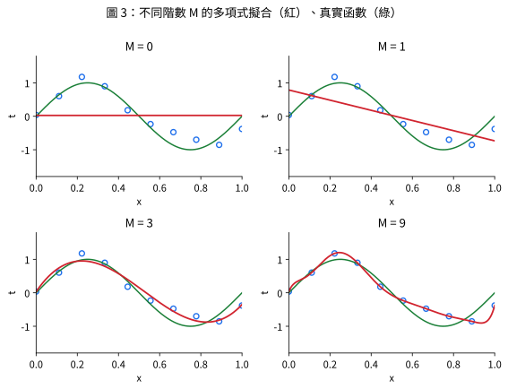
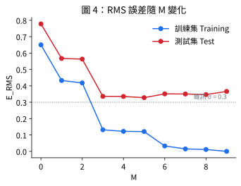
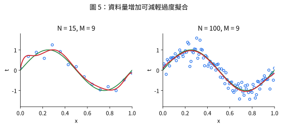
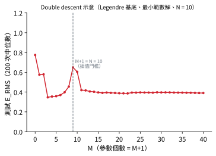

# 泛化與過度擬合 (Generalization and Over-fitting)

## 1. 定義

📌講義：**泛化 (generalization)**：對未曾見過的輸入做出準確預測，是機器學習的核心目標。(來源: [[ch01-deep-learning-revolution]], p.5)

📌講義：**過度擬合 (over-fitting)**：模型對訓練資料擬合得極好（如 $M=9$ 時 $E(\mathbf w^\star)=0$），但曲線劇烈震盪、對底層函數的表示反而極差。訓練誤差小但泛化差，是因為擬合到了雜訊。(來源: [[ch01-deep-learning-revolution]], p.7, p.19)

## 2. 直覺：為什麼更靈活的模型反而更差？

📌講義：給定階數的多項式包含所有較低階多項式為特例，$M=9$ 至少能產生和 $M=3$ 一樣好的結果；$\sin(2\pi x)$ 的冪級數展開含所有階的項，似乎結果應隨 $M$ 增加而單調改善——但實際上不然。檢視係數可知：隨 $M$ 增加，係數量級通常變大，$M=9$ 時係數被精細調到資料上，有巨大正負值，使多項式精確吻合每個資料點但在點間震盪。越靈活的多項式越是在擬合目標值的隨機雜訊。(來源: [[ch01-deep-learning-revolution]], p.8)



## 3. 量化：RMS 誤差

📌講義：以另取的 100 筆測試集 (test set) 評估泛化；實務上用均方根誤差

$$E_{RMS}=\sqrt{\frac1N\sum_{n=1}^N\{y(x_n,\mathbf w)-t_n\}^2}\tag{3}$$

除以 $N$ 使不同大小的資料集可公平比較，開根號使 $E_{RMS}$ 與 $t$ 同尺度、同單位。結果：$M$ 很小時測試誤差大（太不靈活）；$3\le M\le8$ 時測試誤差小；$M=9$ 時訓練誤差歸零（10 個自由度恰可調到 10 個點上）但測試誤差變得很大。(來源: [[ch01-deep-learning-revolution]], p.7)



## 4. 資料量與複雜度

📌講義：對固定的模型複雜度，隨資料集增大，過度擬合問題減輕；資料越多，越能負擔更複雜的模型。古典統計有粗略的經驗法則：資料點數不應少於可學習參數個數的某個倍數（如 5 或 10 倍）。然而在深度學習中，參數數量遠多於訓練資料點數的模型仍可得到極佳結果（講義指向 §9.3.2）。(來源: [[ch01-deep-learning-revolution]], p.8)



> [!warning] 差異：古典法則 vs 深度學習的現象
> - 古典說法：資料點數不應少於參數個數的 5～10 倍。(來源: [[ch01-deep-learning-revolution]], p.8)
> - 深度學習觀察：參數數量遠多於訓練點數仍可表現極佳。(來源: [[ch01-deep-learning-revolution]], p.8)
>
> 兩者在講義中並陳，並以習題 12（double descent）作為延伸討論；本 wiki 不自行裁決，僅在下節提供數值實驗。

## 5. 習題 4、習題 12 解答與實作（對應：第一章習題 4、12）

📌講義：習題 4（⋆RMS 誤差與尺度）：(a) 說明式 (3) 中「除以 $N$」與「開根號」各解決什麼問題；(b) 若 $t'=100t$（如公尺改公分），$E(\mathbf w)$、$E_{RMS}$ 與最佳解 $\mathbf w^\star$ 各如何改變？正則化解 $\mathbf w^\star_\lambda$ 是否也只是等比例縮放？若否，$\lambda$ 應如何調整？(來源: [[ch01-deep-learning-revolution]], p.17)

📌講義：習題 12（⋆⋆多參數也能泛化？）：在 (a) $N=10,M=9$、無正則化，與 (b) $N=10,M=30$、以最小範數解 $\mathbf w^\star=\Phi^+\mathbf t$（$\Phi^+$ 為偽反矩陣）兩種設定下比較測試誤差；觀察到什麼？查閱「double descent」，用一段話說明它與本章「參數不應多於資料」之古典法則的關係（§9.3.2）。(來源: [[ch01-deep-learning-revolution]], p.18)

**以下解答皆為 💡補充：**

### 習題 4

**(a)** *除以 $N$*：$E=\frac12\sum_n(\cdot)^2$ 隨資料筆數 $N$ 線性增長，不同大小的資料集（如訓練集 10 筆、測試集 100 筆）無法直接比較；取平均後與 $N$ 無關。*開根號*：平方使單位變成 $[t]^2$，開根號後回到與 $t$ 相同的單位與尺度，數值可直接解讀為「典型預測誤差大小」。關係：$E_{RMS}=\sqrt{2E/N}$。

**(b)** $t'=100t$，設計矩陣 $\Phi$ 不變。最小平方解對 $\mathbf t$ 線性：$\mathbf w'^\star=(\Phi^T\Phi)^{-1}\Phi^T(100\mathbf t)=100\,\mathbf w^\star$，預測值 $\Phi\mathbf w'^\star=100\,\Phi\mathbf w^\star$，殘差也放大 100 倍，因此
$E'(\mathbf w'^\star)=100^2E(\mathbf w^\star)=10^4E$，$E'_{RMS}=100\,E_{RMS}$，$\mathbf w^\star$ 放大 100 倍。
正則化解 $\mathbf w'_\lambda=(\Phi^T\Phi+\lambda I)^{-1}\Phi^T(100\mathbf t)=100\,\mathbf w_\lambda$ 同樣是等比例縮放，**而且 $\lambda$ 不需要調整**：因為在 $\mathbf w=100\mathbf w_\lambda$ 處，誤差項與懲罰項都恰好放大 $10^4$ 倍，兩者的相對比重不變。（注意：若改變的是**輸入** $x$ 的尺度（如 $x$ 單位改變），$\Phi$ 的各欄尺度改變，$\|\mathbf w\|^2$ 的懲罰不再等價，$\lambda$ 才需要重新選。）

### 習題 12（含 double descent）

```python
import numpy as np


def make_data(n, rng, sigma=0.3):
    x = np.linspace(0.0, 1.0, n)
    return x, np.sin(2 * np.pi * x) + rng.normal(0.0, sigma, n)


def monomial(x, M):
    return np.vander(x, M + 1, increasing=True)


def legendre(x, M):                                   # 在 [0,1] 上良好條件的正交多項式基底
    return np.polynomial.legendre.legvander(2 * x - 1, M)


def erms(Phi, t, w):
    return float(np.sqrt(np.mean((Phi @ w - t) ** 2)))


def min_norm_fit(Phi, t):
    """Phi^+ t：欠定時（參數 > 資料）為「訓練誤差為 0 的所有解中範數最小者」。"""
    return np.linalg.pinv(Phi) @ t


def median_test_error(basis, M, trials=300, N=10):
    errs = []
    for s in range(trials):
        rng = np.random.default_rng(100 + s)
        x, t = make_data(N, rng)
        xv, tv = make_data(100, rng)
        errs.append(erms(basis(xv, M), tv, min_norm_fit(basis(x, M), t)))
    return float(np.median(errs))


# 單次實驗 (seed 0)
rng = np.random.default_rng(0)
x, t = make_data(10, rng)
xt, tt = make_data(100, rng)
for name, M in (("(a) N=10, M=9 ", 9), ("(b) N=10, M=30", 30)):
    w = min_norm_fit(monomial(x, M), t)
    print(f"{name}: 訓練={erms(monomial(x, M), t, w):.1e}  測試={erms(monomial(xt, M), tt, w):.3f}  ||w||={np.linalg.norm(w):.1f}")

# 300 次重複的測試誤差中位數：單項式基底 vs Legendre 基底
print("\n300 次重複的測試 E_RMS 中位數（N=10）")
print("M   單項式   Legendre")
for M in (3, 9, 12, 20, 30):
    print(f"{M:<3} {median_test_error(monomial, M):8.3f} {median_test_error(legendre, M):8.3f}")
```

執行輸出：

```text
(a) N=10, M=9 : 訓練=6.8e-12  測試=0.366  ||w||=128326.8
(b) N=10, M=30: 訓練=1.4e-12  測試=1.693  ||w||=703.1

300 次重複的測試 E_RMS 中位數（N=10）
M   單項式   Legendre
3      0.350    0.350
9      0.637    0.637
12     0.746    0.424
20     3.650    0.399
30    16.451    0.403
```

**觀察與詮釋：**
- 兩種設定的訓練誤差都 ≈ 0（皆內插 10 個資料點）。**用單項式基底**時，(b) 的測試誤差（單次 1.69、300 次中位數 16.5）比 (a)（0.37、0.64）更差——「多參數就能泛化」並沒有自動發生，因為單項式基底在 $[0,1]$ 上高度共線，「最小範數」不等於「平滑」。
- **改用良好條件的 Legendre 基底**時，測試誤差呈現先升後降：在插值門檻 $M+1=N=10$ 附近最差（$M=9$：0.64），再增加參數（$M\ge12$）反而降到約 0.40，接近 $M=3$ 的 0.35。這就是 **double descent**。



💡補充（double descent 與古典法則的關係）：古典偏差—變異權衡預期測試誤差隨模型複雜度呈 U 形，故「參數不應多於資料」；double descent 指出在**插值門檻**（參數數 ≈ 資料數、模型剛好能內插訓練集）測試誤差達到峰值後，繼續增加參數、並選擇隱含偏好小範數（平滑）解的方法（如最小範數解、SGD 的隱式正則化）時，測試誤差會**再次下降**。因此古典法則描述的是曲線的第一段（欠參數化區），過參數化區的行為需要把「隱含的歸納偏差／解的選擇」納入考量。講義建議延伸閱讀 Belkin et al. (2019)。(來源: [[ch01-deep-learning-revolution]], p.21，僅延伸閱讀書目；double descent 解說為 💡補充)

## 與其他概念的關係

- 抑制過度擬合的方法：[[regularization-weight-decay]]、增加資料、[[cross-validation]]。
- 評估與選擇：[[hyperparameters-model-selection]]；教學範例：[[polynomial-curve-fitting]]。
- 現代大模型為何仍能泛化：[[scaling-and-representation-learning]]。

## 自我測驗 Q&A

> [!question] Q1. 訓練誤差為 0 是否代表模型很好？
> [!answer]- 答案
> 不是。$M=9,N=10$ 時訓練誤差為 0 只因 10 個自由度剛好內插 10 個點，模型同時擬合了雜訊，測試誤差反而變大。(來源: [[ch01-deep-learning-revolution]], p.7)

> [!question] Q2. 為什麼比較不同大小資料集時要用 $E_{RMS}$ 而不是 $E$？
> [!answer]- 答案
> $E_{RMS}$ 除以 $N$ 去除了資料量的影響，並開根號回到與 $t$ 同單位的尺度。(來源: [[ch01-deep-learning-revolution]], p.7)

> [!question] Q3. 增加訓練資料對過度擬合有什麼影響？
> [!answer]- 答案
> 對固定模型複雜度，資料越多過度擬合越輕；資料越多越能負擔更複雜的模型（圖 5：$M=9$，$N=15$ vs $N=100$）。(來源: [[ch01-deep-learning-revolution]], p.8)

> [!question] Q4. 若把 $t$ 的單位從公尺改成公分（$t'=100t$），最佳係數與 $E_{RMS}$ 如何改變？
> [!answer]- 答案
> 💡補充：$\mathbf w^\star$ 與 $E_{RMS}$ 都放大 100 倍，$E$ 放大 $10^4$ 倍；正則化解同樣放大 100 倍，且 $\lambda$ 不必調整。

> [!question] Q5. double descent 說明了什麼？
> [!answer]- 答案
> 💡補充：測試誤差在插值門檻（參數數 ≈ 資料數）達到峰值，進入過參數化區後可再次下降，補充了「參數不應多於資料」的古典 U 形權衡；是否真的下降取決於基底與所選解的隱含偏差（見上方單項式 vs Legendre 的實驗）。

## 相關頁面

[[polynomial-curve-fitting]] · [[regularization-weight-decay]] · [[hyperparameters-model-selection]] · [[cross-validation]] · [[scaling-and-representation-learning]] · [[least-squares-normal-equations]]
