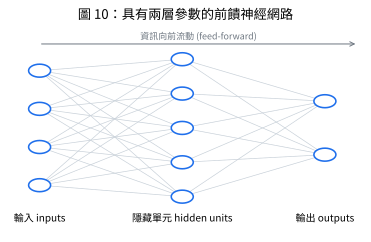

# 神經網路發展簡史 (History of Neural Networks)

📌講義：機器學習有漫長而豐富的歷史；講義聚焦於神經網路方法的演進，因為它們是深度學習的基礎，也已證明是真實應用中最有效的機器學習方法。人工神經網路的歷史依「處理層數」衡量的複雜程度，大致分為三個階段。(來源: [[ch01-deep-learning-revolution]], p.12–13)　三階段對照表見 [[three-eras-of-neural-networks]]。

## 階段一：單層網路（1940s–1960s）

📌講義：McCulloch–Pitts 神經元與感知器，只能學線性可分問題；Minsky–Papert (1969) 後陷入低潮。(來源: [[ch01-deep-learning-revolution]], p.13, p.16)　細節見 [[artificial-neuron-perceptron]]。

## 階段二：反向傳播（1980s–2000s）

📌講義：訓練多層可學習參數網路的解法來自微分學與梯度式最佳化。關鍵改變：(1) 把階梯函數 (7) 換成**連續可微、梯度非零**的激活函數；(2) 引入**可微的誤差函數**，定義給定參數對訓練集目標的預測好壞（如 §1.2.3 的平方和誤差）。於是誤差函數對網路中每個參數的導數都可計算，可以考慮多層參數的網路。(來源: [[ch01-deep-learning-revolution]], p.13)

📌講義：中間層的節點稱為**隱藏單元 (hidden units)**，因為它們的值不出現在訓練集中；每個隱藏單元與輸出單元都計算 (5)–(6) 形式的函數；資訊沿箭頭向前流動，此類模型稱**前饋神經網路 (feed-forward neural networks)**。(來源: [[ch01-deep-learning-revolution]], p.13)



📌講義：訓練時參數先以亂數初始化，再以梯度式最佳化迭代更新，需計算誤差函數的導數，可用**誤差反向傳播 (error backpropagation)**（Rumelhart, Hinton, and Williams, 1986）有效率完成：資訊從輸出端向後流經網路到輸入端。機器學習中最普遍也最簡單的最佳化演算法是**隨機梯度下降 (stochastic gradient descent, SGD)**。(來源: [[ch01-deep-learning-revolution]], p.13–14)　（講義引用原書 Ch. 8（反向傳播）與 Ch. 7（梯度下降）；其中梯度下降對應本講義 Ch7，反向傳播的原書 Ch. 8 未必對應本講義任何章，未提供。）

### 訓練迴圈的骨架（講義）

📌講義：

$$\text{初始化 }\mathbf w\;\xrightarrow{\text{前向傳播}}\;E(\mathbf w)\;\xrightarrow{\text{反向傳播}}\;\nabla_{\mathbf w}E\;\xrightarrow{\text{更新}}\;\mathbf w\leftarrow\mathbf w-\eta\nabla_{\mathbf w}E\;\to\text{重複}$$

$\eta$ 為學習率（超參數）。與 §1.2 的多項式相比，差別只在 $E$ 不再是二次函數，因此沒有閉式解，必須迭代。(來源: [[ch01-deep-learning-revolution]], p.14)

### 歸納偏差與特徵萃取

📌講義：1980 年代中期起，能訓練多層權重的網路帶動復興，也是超越「神經生物學靈感」、建立更嚴謹原則性基礎的時期；機率論與統計學觀念在其中扮演核心角色。關鍵洞見：從資料學習必然涉及背景假設，稱**先驗知識 (prior knowledge)** 或**歸納偏差 (inductive biases)**，可以明確納入（例如設計網路結構使皮膚病灶分類不依賴病灶在影像中的位置——**平移不變性**），也可能是模型形式或訓練方式所隱含的假設。(來源: [[ch01-deep-learning-revolution]], p.14)

📌講義：然而在多層網路中，只有最後兩層權重會學到有用的值；除少數例外——特別是影像分析的**卷積神經網路 (CNN)**（LeCun et al., 1998）——超過兩層的網路幾乎沒有成功應用。為達到合理表現，必須使用手工設計的前處理把輸入變數轉到新空間，稱**特徵萃取 (feature extraction)**；顯然若特徵能從資料學得而非手工打造會好得多。新千禧年之初，神經網路再度觸及能力極限，研究者轉向核方法 (kernel methods)、支援向量機 (SVM)、高斯過程等替代方案。(來源: [[ch01-deep-learning-revolution]], p.14)

## 階段三：深度網路（2010s–）

📌講義：始於 21 世紀第二個十年，一系列進展使多層權重的網路得以有效訓練。多層權重的網路稱**深度神經網路 (deep neural networks)**，聚焦於此的子領域稱**深度學習 (deep learning)**（LeCun, Bengio, and Hinton, 2015）。(來源: [[ch01-deep-learning-revolution]], p.14–15)　詳見 [[scaling-and-representation-learning]]。

## NumPy 範例：最小的反向傳播訓練迴圈（💡補充）

💡補充：以下用兩層網路（2-4-1，tanh 隱藏層、sigmoid 輸出、平方和誤差）訓練 XOR，說明講義的「前向 → 反向 → 更新」迴圈；單層感知器做不到的 XOR（[[artificial-neuron-perceptron]]），這裡因為可微激活與隱藏層而可以學會。為了可重現，使用固定 seed；少數 seed 可能卡在局部極小值，此為梯度式最佳化的正常現象。

```python
import numpy as np

X = np.array([[0, 0], [0, 1], [1, 0], [1, 1]], dtype=float)
y = np.array([[0], [1], [1], [0]], dtype=float)

rng = np.random.default_rng(1)
W1 = rng.normal(0, 1.0, (2, 4)); b1 = np.zeros((1, 4))      # 初始化 w（亂數）
W2 = rng.normal(0, 1.0, (4, 1)); b2 = np.zeros((1, 1))
eta = 0.5                                                   # 學習率（超參數）


def sigmoid(a):
    return 1.0 / (1.0 + np.exp(-a))


for step in range(1, 5001):
    # 前向傳播：a = Σ w x, y = f(a)（式 (5)-(6)），資訊沿箭頭向前
    a1 = X @ W1 + b1
    h = np.tanh(a1)
    a2 = h @ W2 + b2
    out = sigmoid(a2)
    E = 0.5 * np.sum((out - y) ** 2)                        # 平方和誤差

    # 反向傳播：資訊從輸出端向後流，得到 ∇E
    d2 = (out - y) * out * (1 - out)                        # dE/da2
    dW2 = h.T @ d2; db2 = d2.sum(0, keepdims=True)
    d1 = (d2 @ W2.T) * (1 - h ** 2)                         # dE/da1
    dW1 = X.T @ d1; db1 = d1.sum(0, keepdims=True)

    # 更新：w <- w - eta * ∇E
    W1 -= eta * dW1; b1 -= eta * db1
    W2 -= eta * dW2; b2 -= eta * db2

    if step in (1, 100, 1000, 5000):
        print(f"step {step:>4}: E = {E:.5f}")

print("預測:", np.round(out.ravel(), 3), "→ 取整:", (out.ravel() > 0.5).astype(int), "目標:", y.ravel().astype(int))
```

## 自我測驗 Q&A

> [!question] Q1. 從單層網路到可訓練多層網路，需要哪兩個關鍵改變？
> [!answer]- 答案
> (1) 以連續可微、梯度非零的激活函數取代階梯函數；(2) 引入可微的誤差函數。這樣誤差對每個參數的導數都可計算，才能用梯度式最佳化訓練多層網路。(來源: [[ch01-deep-learning-revolution]], p.13)

> [!question] Q2. 寫出講義的訓練迴圈，並說明它與多項式曲線擬合的差別。
> [!answer]- 答案
> 初始化 $\mathbf w$ → 前向傳播算 $E(\mathbf w)$ → 反向傳播算 $\nabla_{\mathbf w}E$ → $\mathbf w\leftarrow\mathbf w-\eta\nabla_{\mathbf w}E$ → 重複。差別：網路的 $E$ 不是二次函數，沒有閉式解，必須迭代。(來源: [[ch01-deep-learning-revolution]], p.14)

> [!question] Q3. 什麼是歸納偏差？舉一個設計進網路結構的例子。
> [!answer]- 答案
> 從資料學習所必然涉及的背景假設（先驗知識）。例：用卷積結構讓皮膚病灶分類不依賴病灶位置（平移不變性）。(來源: [[ch01-deep-learning-revolution]], p.14)

> [!question] Q4. 為什麼 2000 年代神經網路一度讓位給核方法／SVM？
> [!answer]- 答案
> 當時超過兩層的網路難以有效訓練（除 CNN），須靠手工特徵萃取，能力再度觸及極限，研究者轉向其他方法。(來源: [[ch01-deep-learning-revolution]], p.14)

## 相關頁面

[[three-eras-of-neural-networks]] · [[artificial-neuron-perceptron]] · [[scaling-and-representation-learning]] · [[linear-models-basis-functions]] · [[least-squares-normal-equations]]
