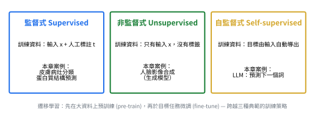

# 三種學習典範 (Learning Paradigms)



## 1. 核心定義

📌講義：本章四個案例皆以同一套深度學習框架的變體解決，與傳統「每種應用需截然不同專門技術」形成對比。四個案例引入基本術語。(來源: [[ch01-deep-learning-revolution]], p.2)

| 典範 | 訓練資料的形式 | 本章案例 |
|---|---|---|
| **監督式 (supervised)** | 輸入 + 人工標註的目標 | 皮膚病灶分類、蛋白質結構預測 |
| **非監督式 (unsupervised)** | 只有輸入，無標籤 | 人臉影像合成（生成模型） |
| **自監督式 (self-supervised)** | 目標從輸入自動導出 | LLM 的「預測下一個詞」 |

(來源: [[ch01-deep-learning-revolution]], p.4)　完整對照見 [[supervised-vs-unsupervised-vs-self-supervised]]。

📌講義：**遷移學習**是跨越典範的訓練策略：先在大資料上預訓練 (pre-train)，再於目標任務上微調 (fine-tune)。(來源: [[ch01-deep-learning-revolution]], p.4)　見 [[transfer-learning]]。

## 2. 四個案例

### 2.1 皮膚癌影像分類（監督式、分類）

📌講義：黑色素瘤是最危險的皮膚癌，但及早發現可治癒；區分「惡性黑色素瘤」與「良性痣」幾乎不可能手工寫出合理準確率的演算法。解法使用一大批已標註為「惡性」或「良性」的病灶影像（**訓練集**，標籤來自切片檢查 biopsy 的真實類別），用來決定深度神經網路中約 2,500 萬個可調參數（**權重**）；由資料決定參數值的過程稱**學習／訓練**。目標是讓訓練後的網路僅憑影像預測新病灶的標籤，省去耗時的切片步驟（Esteva et al., 2017）。(來源: [[ch01-deep-learning-revolution]], p.2)

📌講義：**監督式學習**：每筆訓練樣本都附有「正確答案」（標籤）。**分類**：輸出為離散類別集合（如良性／惡性）。**迴歸**：輸出為一個或多個連續變數（例如以溫度、壓力、反應物濃度預測化工製程產率）。(來源: [[ch01-deep-learning-revolution]], p.3)

### 2.2 蛋白質結構預測（監督式）

📌講義：蛋白質由一條或多條胺基酸長鏈（共 22 種胺基酸）構成，其 3D 結構決定行為與交互作用。「給定胺基酸序列，計算其 3D 結構」是生物學半世紀的基本開放問題。3D 結構可由 X 光晶體繞射、冷凍電子顯微鏡或核磁共振測得但極耗時；序列測定則成本低、通量高。深度學習模型以「序列為輸入、3D 結構為輸出」訓練，訓練資料為序列與結構皆已知的蛋白質——又是監督式學習（Jumper et al., 2021，即 AlphaFold）。(來源: [[ch01-deep-learning-revolution]], p.3)

### 2.3 影像合成（非監督式、生成模型）

📌講義：訓練資料只是一批樣本影像，目標是讓網路生成同類型的新影像；影像沒有標籤，故為**非監督式學習**。**生成模型 (generative model)** 能產生「與訓練樣本不同、但具有相同統計性質」的新輸出。若生成內容依賴一段輸入文字（**提示 prompt**），使影像反映文字語意，即「文生圖」變體；**生成式 AI (generative AI)** 泛指輸出為影像、影片、音訊、文字、候選藥物分子等各種模態的深度學習模型。(來源: [[ch01-deep-learning-revolution]], p.3)

### 2.4 大型語言模型（自監督式、自迴歸）

📌講義：LLM 利用深度學習建立能捕捉語言語意性質的豐富內部表徵；其中**自迴歸語言模型 (autoregressive language model)** 以語言為輸出，屬於生成式 AI。(來源: [[ch01-deep-learning-revolution]], p.4)

📌講義（範例 1.1.1 自迴歸式文字生成）：模型以「一串詞」為輸入，輸出一個代表序列中「下一個詞」的詞；把新詞接在序列末端再餵回模型即可產生下一個詞，重複此程序便能生成長文。模型也能輸出特殊的「停止」詞以結束生成。使用者可再接上自己的詞、餵回模型觸發後續生成——人與神經網路的「對話」即由此而來。(來源: [[ch01-deep-learning-revolution]], p.4)

📌講義：訓練方式：從文本中隨機抽取一段詞序列為輸入，以已知的「下一個詞」為目標輸出，構成訓練配對。這是**自監督式學習**的例子——雖然學的是「輸入→輸出」的函數，但標籤自動從輸入資料取得，無須額外人工標註；多種來源皆有大量文本，所以可擴展到極大的訓練集與極大的神經網路。(來源: [[ch01-deep-learning-revolution]], p.4)

📌講義（講義教學補充）：四個案例的共同結構是「以資料決定一個有數百萬至數兆參數的函數」。在通訊與導航領域，同樣框架用於：以歷史觀測預測電離層總電子含量 (VTEC) 以修正 GNSS 單頻定位誤差（迴歸）；雷達／聲學陣列的到達方向 (DOA) 估計（可視為分類或迴歸）；海事網路入侵偵測（分類）。值得思考：這些問題中「標籤」從何而來？能否像 LLM 一樣採用自監督（例如以過去時間序列預測未來值）免除人工標註？(來源: [[ch01-deep-learning-revolution]], p.4)

## 3. 習題 1 解答（對應：第一章習題 1）

📌講義：習題 1（◦學習典範辨識）：下列問題屬於監督式、非監督式或自監督式學習？屬於分類還是迴歸？並說明其「標籤」從何而來。(a) 以船舶 AIS 軌跡資料預測其 10 分鐘後的位置；(b) 將海量衛星影像分群，找出彼此相似的海況；(c) 從 GNSS 觀測量判斷某接收機是否遭受欺騙 (spoofing) 攻擊；(d) 以過去 24 小時的 VTEC 序列預測下一小時的 VTEC。(來源: [[ch01-deep-learning-revolution]], p.16)

**以下解答皆為 💡補充**（同一問題依資料來源可能有不同合理答案，已一併說明）：

| 小題 | 典範 | 分類／迴歸 | 標籤從何而來 |
|---|---|---|---|
| (a) AIS 預測 10 分鐘後位置 | **自監督式**（亦可視為監督式） | **迴歸**（位置為連續變數） | 標籤是同一條軌跡 10 分鐘後的實際位置，直接由歷史資料取得，無須人工標註 |
| (b) 衛星影像分群 | **非監督式** | 都不是（是**分群 clustering**） | 沒有標籤；群的意義由事後解讀 |
| (c) 判斷是否遭欺騙攻擊 | **監督式**（若有標註）；若沒有攻擊標註，則改用非監督式異常偵測 | **分類**（二元：正常／被欺騙） | 標籤來自受控實驗、模擬器注入的欺騙訊號，或專家／事後驗證的標註 |
| (d) 24 小時 VTEC 預測下一小時 | **自監督式**（亦可視為監督式） | **迴歸** | 標籤是「下一小時的實際 VTEC」，由時間序列自己提供 |

判斷重點：看「標籤是否需要額外的人工標註」。(a)(d) 的標籤是資料本身未來的值，屬自監督（講義亦提示此觀點）；(c) 需要「是否被攻擊」的真值，屬監督式；(b) 完全沒有目標值，屬非監督式。

## 4. NumPy 範例（💡補充）

以下四段程式分別示範監督式、非監督式（分群與生成）、自監督式（時間序列）與自迴歸生成的最小版本，皆已實際執行。

```python
import numpy as np

rng = np.random.default_rng(0)

# ---------- 1. 監督式（迴歸）：有 (x, t) 配對，學習 x -> t ----------
x = rng.uniform(0, 1, 50)
t = 2.0 * x + 1.0 + rng.normal(0, 0.1, 50)             # t 是「人工標註」的目標
Phi = np.stack([np.ones_like(x), x], axis=1)
w = np.linalg.lstsq(Phi, t, rcond=None)[0]
print("監督式：學到 w =", np.round(w, 2), "(真值 [1, 2])")

# ---------- 2a. 非監督式：只有輸入，用 k-means 分群（習題 1(b)） ----------
A = rng.normal([0, 0], 0.4, (60, 2))
B = rng.normal([3, 3], 0.4, (60, 2))
data = np.vstack([A, B])                               # 沒有任何標籤
centers = data[rng.choice(len(data), 2, replace=False)]
for _ in range(10):
    labels = np.argmin(((data[:, None] - centers) ** 2).sum(-1), axis=1)
    centers = np.array([data[labels == k].mean(0) for k in range(2)])
print("非監督式：k-means 群中心 =", np.round(np.sort(centers, axis=0), 2).tolist())

# ---------- 2b. 非監督式：最簡單的「生成模型」——學統計性質，再抽新樣本 ----------
mu, cov = data.mean(0), np.cov(data.T)
new_samples = rng.multivariate_normal(mu, cov, 5)      # 與訓練樣本不同，但統計性質相同
print("生成的新樣本（前 2 筆）:", np.round(new_samples[:2], 2).tolist())

# ---------- 3. 自監督式：標籤由輸入序列自動導出（習題 1(a)(d)） ----------
steps = np.arange(300)
series = np.sin(0.2 * steps) + 0.05 * rng.normal(size=300)
k = 5                                                  # 用過去 5 點預測下一點
X_ss = np.stack([series[i:i + k] for i in range(len(series) - k)])
y_ss = series[k:]                                      # 目標＝序列自己的下一個值，無需人工標註
w_ss = np.linalg.lstsq(X_ss, y_ss, rcond=None)[0]
pred = X_ss @ w_ss
print("自監督式：一步預測 RMS 誤差 =", round(float(np.sqrt(np.mean((pred - y_ss) ** 2))), 4))

# ---------- 4. 自迴歸文字生成（範例 1.1.1 的玩具版：字元 bigram） ----------
text = "deep learning learns from data. "
chars = sorted(set(text))
idx = {c: i for i, c in enumerate(chars)}
counts = np.ones((len(chars), len(chars)))            # 加一平滑
for a, b in zip(text[:-1], text[1:]):                  # 訓練配對：(前一字元 -> 下一字元)，自監督
    counts[idx[a], idx[b]] += 1
prob = counts / counts.sum(1, keepdims=True)

seq = "d"
for _ in range(30):                                    # 每次把新字元接到序列末端，再餵回模型
    nxt = rng.choice(len(chars), p=prob[idx[seq[-1]]])
    seq += chars[nxt]
    if chars[nxt] == ".":                              # 「停止」符號
        break
print("自迴歸生成:", repr(seq))
```

## 自我測驗 Q&A

> [!question] Q1. 監督式、非監督式、自監督式學習的差別是什麼？各舉本章一例。
> [!answer]- 答案
> 監督式：輸入＋人工標註目標（皮膚病灶分類）；非監督式：只有輸入、無標籤（人臉影像合成）；自監督式：目標由輸入自動導出（LLM 預測下一個詞）。(來源: [[ch01-deep-learning-revolution]], p.4)

> [!question] Q2. 分類與迴歸的差別？
> [!answer]- 答案
> 分類的輸出是離散類別（良性／惡性）；迴歸的輸出是一個或多個連續變數（化工製程產率）。(來源: [[ch01-deep-learning-revolution]], p.3)

> [!question] Q3. LLM 為什麼是「自監督」而不是「監督」？
> [!answer]- 答案
> 雖然學的是輸入→輸出函數，但標籤（下一個詞）自動從輸入文本取得，不需額外人工標註，因此能擴展到極大的訓練集。(來源: [[ch01-deep-learning-revolution]], p.4)

> [!question] Q4. 什麼是生成模型？它屬於哪一種學習典範？
> [!answer]- 答案
> 能產生與訓練樣本不同、但具有相同統計性質之新輸出的模型；影像合成例子屬非監督式。(來源: [[ch01-deep-learning-revolution]], p.3)

> [!question] Q5. 以過去 24 小時 VTEC 預測下一小時 VTEC：典範與任務類型？
> [!answer]- 答案
> 💡補充：自監督式（亦可稱監督式）的**迴歸**問題；標籤是下一小時的實際 VTEC，由時間序列本身提供。

## 相關頁面

[[supervised-vs-unsupervised-vs-self-supervised]] · [[transfer-learning]] · [[polynomial-curve-fitting]] · [[scaling-and-representation-learning]] · [[history-of-neural-networks]]
