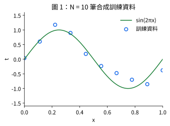
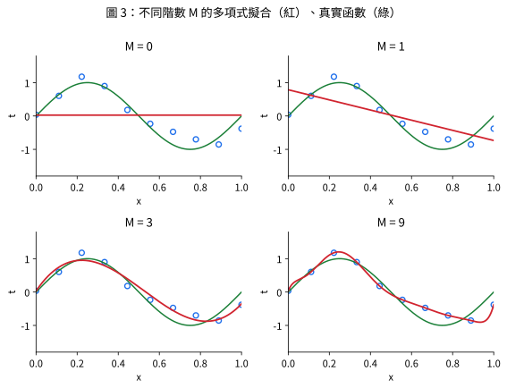
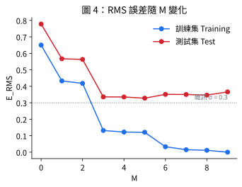
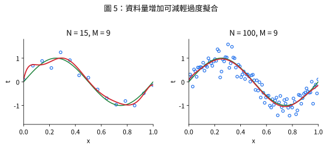
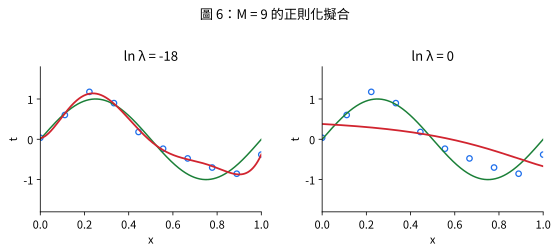
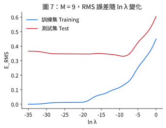

# 多項式曲線擬合 (Polynomial Curve Fitting)

> [!note] 本頁定位
> 這是第 1 章用來引入幾乎所有基本詞彙的**教學範例**。本頁彙整整個範例的資料、結果與第 1 章習題 11 的完整 NumPy 實作；各子概念的細節見 [[generalization-overfitting]]、[[regularization-weight-decay]]、[[hyperparameters-model-selection]]、[[least-squares-normal-equations]]。

## 1. 問題設定

📌講義：以多項式擬合小型合成資料，是一個**監督式學習**問題：給定輸入變數 $x$ 的值，預測目標變數 $t$。對未曾見過的輸入做出準確預測，稱為**泛化 (generalization)**。(來源: [[ch01-deep-learning-revolution]], p.4–5)

📌講義：合成資料的產生方式：在 $[0,1]$ 上均勻取 $N=10$ 個 $x_n$，計算 $\sin(2\pi x_n)$ 後加上少量高斯雜訊，得到 $t_n$。資料中存在想學習的底層規律，但個別觀測受隨機雜訊干擾。(來源: [[ch01-deep-learning-revolution]], p.5)



## 2. 模型：對參數線性的多項式

📌講義：

$$y(x,\mathbf{w}) = w_0 + w_1 x + \cdots + w_M x^M = \sum_{j=0}^{M} w_j x^j \tag{1}$$

$M$ 為階數 (order)。$y$ 是 $x$ 的非線性函數，卻是係數 $\mathbf{w}$ 的**線性**函數。令 $\boldsymbol\phi(x)=(1,x,\dots,x^M)^T$，則 $y=\mathbf{w}^T\boldsymbol\phi(x)$。(來源: [[ch01-deep-learning-revolution]], p.5)　更多見 [[linear-models-basis-functions]]。

## 3. 誤差函數與最小平方解

📌講義：以平方和誤差 $E(\mathbf{w})=\frac12\sum_{n=1}^N\{y(x_n,\mathbf{w})-t_n\}^2$ 衡量擬合程度；它是 $\mathbf{w}$ 的二次函數，因此有唯一的閉式解 $\mathbf{w}^\star=(\Phi^T\Phi)^{-1}\Phi^T\mathbf{t}$。(來源: [[ch01-deep-learning-revolution]], p.6)　推導見 [[least-squares-normal-equations]]。

## 4. 模型複雜度與過度擬合

📌講義：以 $M=0,1,3,9$ 擬合圖 1 資料：$M=0,1$ 擬合不佳；$M=3$ 近似最好；$M=9$ 精確通過每個資料點 ($E(\mathbf{w}^\star)=0$)，但曲線劇烈震盪，稱為**過度擬合 (over-fitting)**。(來源: [[ch01-deep-learning-revolution]], p.7)



📌講義：講義表 1 列出各階的係數 $\mathbf{w}^\star$（見下表），係數量級隨 $M$ 急遽增大；$M=9$ 時出現約 $10^6$ 的巨大正負係數。(來源: [[ch01-deep-learning-revolution]], p.8)

| 係數 | M=0 | M=1 | M=3 | M=9 |
|---|---|---|---|---|
| $w_0^\star$ | −0.00 | 0.53 | 0.22 | 0.17 |
| $w_1^\star$ | | −1.07 | 6.84 | −374.59 |
| $w_2^\star$ | | | −23.98 | 8,781.65 |
| $w_3^\star$ | | | 17.27 | −79,006.74 |
| $w_4^\star$ | | | | 369,642.57 |
| $w_5^\star$ | | | | −1,002,582.44 |
| $w_6^\star$ | | | | 1,634,413.51 |
| $w_7^\star$ | | | | −1,578,398.99 |
| $w_8^\star$ | | | | 831,584.04 |
| $w_9^\star$ | | | | −184,058.92 |

💡補充：以下是本 wiki 用 `seed=0`、$\sigma=0.3$、均勻格點重新跑出的結果（程式見第 6 節）。**數值與講義表 1 不同是正常的**（講義也註明圖形由自己的程序重新產生，數值與原書略有差異，p.5），但趨勢一致：$M=9$ 時訓練誤差為 0、係數高達 $10^4\sim10^5$ 量級。

| M | 訓練 $E_{RMS}$ | 測試 $E_{RMS}$ |
|---|---|---|
| 0 | 0.650 | 0.778 |
| 1 | 0.433 | 0.567 |
| 3 | 0.132 | 0.336 |
| 5 | 0.121 | 0.328 |
| 7 | 0.015 | 0.350 |
| 9 | 0.000 | 0.366 |

> [!tip] 💡補充：為什麼我的測試誤差降不到 0？
> 測試資料的目標值 $t$ 也含有 $\sigma=0.3$ 的雜訊，所以即使模型完美地學到 $\sin(2\pi x)$，測試 $E_{RMS}$ 仍約為 0.3（雜訊底線）。這也是 $M=9$ 在這組隨機資料上看起來「只」略差於 $M=3$ 的原因；換不同 seed 或減少 $N$，過度擬合會更明顯。



📌講義：資料越多，過度擬合越輕（$M=9$：$N=15$ 與 $N=100$ 的比較）。(來源: [[ch01-deep-learning-revolution]], p.8–9)



## 5. 正則化與超參數

📌講義：在誤差函數加入 $\frac{\lambda}{2}\|\mathbf{w}\|^2$ 抑制係數量級；$\ln\lambda=-18$ 時過度擬合被抑制，$\ln\lambda=0$ 則擬合過於僵硬。(來源: [[ch01-deep-learning-revolution]], p.9–10)　詳見 [[regularization-weight-decay]]。





## 6. 習題 11 完整 NumPy 實作（對應：第一章習題 11）

📌講義：習題 11 要求以 NumPy 重現圖 1–7：(a) $N=10$、$t_n=\sin 2\pi x_n+\epsilon_n$、$\epsilon_n\sim\mathcal N(0,0.3^2)$，以正規方程擬合 $M=0,1,3,9$ 並列出係數；(b) 另產生 100 筆測試資料，畫 $E_{RMS}$ 對 $M$；(c) 固定 $M=9$ 掃描 $\ln\lambda\in[-35,0]$，找最佳 $\lambda$；(d) $N=15$ 與 $100$ 重做 (a)；(e) 延伸：改用 Fourier 基底 $\{1,\sin 2\pi kx,\cos 2\pi kx\}_{k=1}^K$ 重做 (a)–(c)，並說明為何 $K=1$ 幾乎完美，以及這說明「歸納偏差」什麼道理。(來源: [[ch01-deep-learning-revolution]], p.18)

💡補充：下列程式為本 wiki 補充的實作（NumPy only，已實際執行）。小提醒：$M=9,N=10$ 時 $\Phi^T\Phi$ 的條件數約 $10^{14}$，直接 `solve(Phi.T@Phi, Phi.T@t)` 會有明顯數值誤差（訓練誤差約 $10^{-6}$ 而非 0），所以改用等價但較穩定的 `lstsq`；兩者在數學上是同一個最小平方問題。

```python
import numpy as np

SHOW = False  # 設為 True 可畫圖（需要 matplotlib）
rng = np.random.default_rng(0)


def make_data(n, rng, sigma=0.3):
    x = np.linspace(0.0, 1.0, n)                      # 均勻格點
    t = np.sin(2 * np.pi * x) + rng.normal(0.0, sigma, n)
    return x, t


def poly(x, M):                                       # 設計矩陣 Phi[n, j] = x_n**j
    return np.vander(x, M + 1, increasing=True)


def fit_ls(Phi, t):                                   # 最小平方解（等價於正規方程，數值較穩）
    return np.linalg.lstsq(Phi, t, rcond=None)[0]


def fit_ridge(Phi, t, lam):                           # 式 (4) 的閉式解
    return np.linalg.solve(Phi.T @ Phi + lam * np.eye(Phi.shape[1]), Phi.T @ t)


def erms(Phi, t, w):                                  # 式 (3)
    return float(np.sqrt(np.mean((Phi @ w - t) ** 2)))


# (a) N=10，M = 0, 1, 3, 9
x, t = make_data(10, rng)
xt, tt = make_data(100, rng)                          # (b) 100 筆測試資料
np.set_printoptions(precision=2, suppress=True, linewidth=120)
for M in (0, 1, 3, 9):
    w = fit_ls(poly(x, M), t)
    print(f"M={M}: w* =", w)

# (b) E_RMS 對 M
print("\nM  train  test")
for M in range(10):
    w = fit_ls(poly(x, M), t)
    print(f"{M}  {erms(poly(x, M), t, w):.3f}  {erms(poly(xt, M), tt, w):.3f}")

# (c) M=9，掃描 ln(lambda) in [-35, 0]
P, Pt = poly(x, 9), poly(xt, 9)
ln_lams = np.linspace(-35, 0, 351)
test_err = [erms(Pt, tt, fit_ridge(P, t, np.exp(l))) for l in ln_lams]
best = int(np.argmin(test_err))
print(f"\n(c) 測試誤差最小時 ln(lambda) = {ln_lams[best]:.1f}, E_RMS = {test_err[best]:.3f}")

# (d) N = 15 與 100，M = 9（無正則化）
for N in (15, 100):
    xn, tn = make_data(N, np.random.default_rng(1))
    w = fit_ls(poly(xn, 9), tn)
    print(f"(d) N={N}: train={erms(poly(xn, 9), tn, w):.3f}, test={erms(Pt, tt, w):.3f}, max|w|={np.abs(w).max():.0f}")


# (e) Fourier 基底 {1, sin 2*pi*k*x, cos 2*pi*k*x}, k = 1..K
def fourier(x, K):
    cols = [np.ones_like(x)]
    for k in range(1, K + 1):
        cols += [np.sin(2 * np.pi * k * x), np.cos(2 * np.pi * k * x)]
    return np.stack(cols, axis=1)


print()
for K in (1, 2, 4):
    w = fit_ls(fourier(x, K), t)
    print(f"(e) K={K}: train={erms(fourier(x, K), t, w):.3f}, test={erms(fourier(xt, K), tt, w):.3f}, w*={w}")

if SHOW:
    import matplotlib.pyplot as plt
    xx = np.linspace(0, 1, 400)
    fig, axes = plt.subplots(2, 2, figsize=(8, 6))
    for ax, M in zip(axes.ravel(), (0, 1, 3, 9)):
        ax.scatter(x, t, facecolor="none", edgecolor="b")
        ax.plot(xx, np.sin(2 * np.pi * xx), "g")
        ax.plot(xx, poly(xx, M) @ fit_ls(poly(x, M), t), "r")
        ax.set_title(f"M = {M}")
    plt.show()
```

執行輸出（節錄，seed=0）：

```text
M=3: w* = [  0.03   9.09 -25.92  16.44]
(c) 測試誤差最小時 ln(lambda) = -9.1, E_RMS = 0.331
(d) N=15: train=0.141, test=0.324, max|w|=18712
(d) N=100: train=0.253, test=0.307, max|w|=14685
(e) K=1: train=0.196, test=0.301, w*=[ 0.04  0.91 -0.12]
(e) K=2: train=0.104, test=0.333, w*=[ 0.05  0.91 -0.09  0.14 -0.19]
```

**(c) 的注意事項**：上面直接以「測試集」挑 $\lambda$ 只是為了重現講義圖 7；嚴謹的做法應用驗證集或交叉驗證選，測試集只留給最後一次評估（見 [[hyperparameters-model-selection]]）。

**(e) 的解答（💡補充）**：$\sin 2\pi x$ 恰好落在基底 $\{1,\sin2\pi x,\cos2\pi x\}$ 的張成空間內，所以 $K=1$（僅 3 個參數）就能學到 $w_{\sin}\approx0.91$（真值為 1，差距來自雜訊）、其餘係數接近 0，測試 $E_{RMS}=0.301\approx\sigma$，已達雜訊底線；多加基底（$K=2,4$）反而讓訓練誤差變小、測試誤差變大。這說明**歸納偏差 (inductive bias)**：若選擇的函數族本身就貼近資料的真實結構，則只需極少參數即可泛化良好；基底選錯（如多項式）則要付出更多參數與更大過度擬合風險。對照 [[history-of-neural-networks]]：深度學習的關鍵是讓基底函數也由資料學得。

## 與其他概念的關係

- 多項式是單一神經元的特例：[[artificial-neuron-perceptron]]
- 閉式解推導：[[least-squares-normal-equations]]；資料分割與選參：[[hyperparameters-model-selection]]、[[cross-validation]]

## 自我測驗 Q&A

> [!question] Q1. 為什麼說多項式 $y(x,\mathbf{w})$ 是「線性模型」？
> [!answer]- 答案
> 因為它對**參數** $\mathbf{w}$ 是線性的（$y=\mathbf{w}^T\boldsymbol\phi(x)$），雖然對輸入 $x$ 是非線性的。固定基底函數 $\phi_j(x)=x^j$，只學習組合係數。(來源: [[ch01-deep-learning-revolution]], p.5)

> [!question] Q2. $M=9$、$N=10$ 時為何訓練誤差恰為 0，但測試誤差卻不好？
> [!answer]- 答案
> 9 階多項式有 10 個自由度，恰可精確通過 10 個訓練點，所以 $E(\mathbf{w}^\star)=0$；但它同時擬合了雜訊，在資料點之間劇烈震盪，對新資料預測差，這就是過度擬合。(來源: [[ch01-deep-learning-revolution]], p.7)

> [!question] Q3. 觀察表 1，過度擬合時係數有什麼特徵？
> [!answer]- 答案
> 係數量級變得非常大且正負交錯（$M=9$ 時達 $10^5\sim10^6$），多項式靠大係數互相抵消來精確吻合每個資料點。正則化就是抑制這種現象。(來源: [[ch01-deep-learning-revolution]], p.8)

> [!question] Q4. 為什麼測試 $E_{RMS}$ 不會低於約 0.3？
> [!answer]- 答案
> 💡補充：測試目標值本身含 $\sigma=0.3$ 的雜訊，這是不可消除的誤差（雜訊底線），與模型好壞無關。

## 相關頁面

[[generalization-overfitting]] · [[regularization-weight-decay]] · [[hyperparameters-model-selection]] · [[least-squares-normal-equations]] · [[linear-models-basis-functions]] · [[learning-paradigms]]
