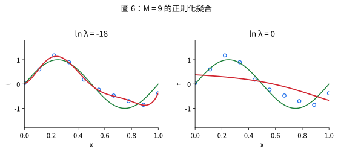
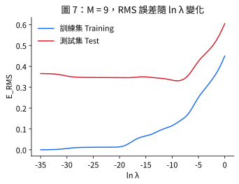

# 正則化與權重衰減 (Regularization and Weight Decay)

## 1. 定義與動機

📌講義：「必須依訓練集大小來限制參數數量」令人不甚滿意，更合理的做法是依問題本身的複雜度選擇模型複雜度。控制過度擬合的常用技術是**正則化 (regularization)**：在誤差函數中加入懲罰項以抑制係數過大。最簡單的懲罰項是係數平方和：

$$\widetilde E(\mathbf w)=\frac12\sum_{n=1}^N\{y(x_n,\mathbf w)-t_n\}^2+\frac{\lambda}{2}\|\mathbf w\|^2 \tag{4}$$

其中 $\|\mathbf w\|^2=\mathbf w^T\mathbf w=w_0^2+\cdots+w_M^2$，係數 $\lambda$ 決定正則化項相對於平方和誤差項的重要性。(來源: [[ch01-deep-learning-revolution]], p.8–9)

📌講義：常見做法是把 $w_0$ 排除在正則化項之外（納入會使結果依賴目標變數原點的選擇），或給 $w_0$ 獨立的正則化係數。這類技術在統計文獻稱為**收縮法 (shrinkage methods)**；在神經網路稱為**權重衰減 (weight decay)**，因為此項促使權重朝零衰減。(來源: [[ch01-deep-learning-revolution]], p.9)

> [!note] 講義引用
> 講義將 $w_0$ 的處理與「正則化」細節指向 §9.2.1、§9.3.2（講義引用原書 Ch. 9，未必對應本講義 Ch9，未提供）。

## 2. 閉式解推導

📌講義：
$$\widetilde E(\mathbf w)=\tfrac12\|\Phi\mathbf w-\mathbf t\|^2+\tfrac\lambda2\mathbf w^T\mathbf w,\quad \nabla_{\mathbf w}\widetilde E=(\Phi^T\Phi+\lambda I)\mathbf w-\Phi^T\mathbf t=0$$
$$\Longrightarrow\;\mathbf w^\star_\lambda=(\Phi^T\Phi+\lambda I)^{-1}\Phi^T\mathbf t$$
即使 $\Phi^T\Phi$ 奇異（如 $M+1>N$），只要 $\lambda>0$，$\Phi^T\Phi+\lambda I$ 恆為正定、可逆——正則化同時解決「數值病態」與「過度擬合」。這就是統計學的**脊迴歸 (ridge regression)**。(來源: [[ch01-deep-learning-revolution]], p.9)

## 3. 效果：係數縮小

📌講義：$M=9$ 時，$\ln\lambda=-18$ 已抑制過度擬合，曲線與 $\sin(2\pi x)$ 相當接近；$\lambda$ 太大（$\ln\lambda=0$）又得到不佳擬合。(來源: [[ch01-deep-learning-revolution]], p.9–10)

| 係數 | $\ln\lambda=-\infty$ | $\ln\lambda=-18$ | $\ln\lambda=0$ |
|---|---|---|---|
| $w_0^\star$ | 0.17 | 0.16 | 0.26 |
| $w_1^\star$ | −374.59 | 8.50 | −0.42 |
| $w_2^\star$ | 8,781.65 | −36.30 | −0.35 |
| $w_3^\star$ | −79,006.74 | 75.66 | −0.20 |
| $w_4^\star$ | 369,642.57 | −131.95 | −0.07 |
| $w_5^\star$ | −1,002,582.44 | 57.07 | 0.03 |
| $w_6^\star$ | 1,634,413.51 | 143.36 | 0.10 |
| $w_7^\star$ | −1,578,398.99 | −52.52 | 0.15 |
| $w_8^\star$ | 831,584.04 | −172.88 | 0.19 |
| $w_9^\star$ | −184,058.92 | 109.15 | 0.22 |

（講義表 2，來源: [[ch01-deep-learning-revolution]], p.10）





📌講義：$\lambda$ 現在控制模型的**有效複雜度 (effective complexity)**，從而決定過度擬合程度。$\lambda$ 是超參數，不能與 $\mathbf w$ 一起對誤差函數聯合最小化（見 [[hyperparameters-model-selection]]）。(來源: [[ch01-deep-learning-revolution]], p.10)

## 4. 貝氏詮釋（講義教學補充）

📌講義（講義教學補充）：假設 $t_n=y(x_n,\mathbf w)+\epsilon_n$，$\epsilon_n\sim\mathcal N(0,\sigma^2)$，並對權重放高斯先驗 $p(\mathbf w)=\mathcal N(\mathbf w\mid0,\alpha^{-1}I)$，則
$$-\ln p(\mathbf w\mid\mathbf t)=\frac1{2\sigma^2}\sum_n\{y(x_n,\mathbf w)-t_n\}^2+\frac\alpha2\|\mathbf w\|^2+\text{常數}.$$
最大化後驗 (MAP) 等價於最小化式 (4)，其中 $\lambda=\alpha\sigma^2$。因此「正則化＝先驗知識」：$\lambda$ 越大，越相信真實權重應該很小；這是「歸納偏差」的精確實例。(來源: [[ch01-deep-learning-revolution]], p.9)　（講義預告 §2.6 與 Ch. 9：講義引用原書 Ch. 2、Ch. 9，未必對應本講義 Ch2、Ch9，未提供。）

## 5. 習題 3、習題 5 解答與推導（對應：第一章習題 3、5）

📌講義：習題 3（⋆正則化閉式解與收縮效應）：(a) 由式 (4) 導出 $\mathbf w^\star_\lambda$；(b) 令 $\Phi^T\Phi=U\Lambda U^T$，特徵值 $\mu_j\ge0$，證明在特徵基底下正則化解的第 $j$ 分量是無正則化解對應分量乘以收縮因子 $\mu_j/(\mu_j+\lambda)$，並解釋為何對「小特徵值方向」抑制最強；(c) 證明 $\|\mathbf w^\star_\lambda\|$ 是 $\lambda$ 的非增函數，並與表 2 對照。(來源: [[ch01-deep-learning-revolution]], p.17)

📌講義：習題 5（⋆權重衰減的 MAP 詮釋）：設 $t_n=y(x_n,\mathbf w)+\epsilon_n$，$\epsilon_n\overset{iid}\sim\mathcal N(0,\sigma^2)$，先驗 $p(\mathbf w)=\mathcal N(\mathbf w\mid0,\alpha^{-1}I)$。(a) 寫出 $\ln p(\mathbf t\mid\mathbf w)$ 與 $\ln p(\mathbf w\mid\mathbf t)$；(b) 證明 MAP 等價最小化式 (4) 並求 $\lambda$ 與 $\alpha,\sigma^2$ 的關係；(c) 若改用 Laplace 先驗 $p(\mathbf w)\propto\exp(-\beta\|\mathbf w\|_1)$，對應正則化項為何？此即 LASSO；從幾何上說明為何傾向稀疏。(來源: [[ch01-deep-learning-revolution]], p.17)

**以下解答皆為 💡補充：**

### 習題 3

**(a)** 對 $\widetilde E=\frac12\|\Phi\mathbf w-\mathbf t\|^2+\frac\lambda2\mathbf w^T\mathbf w$ 求梯度：$\nabla\widetilde E=\Phi^T(\Phi\mathbf w-\mathbf t)+\lambda\mathbf w=(\Phi^T\Phi+\lambda I)\mathbf w-\Phi^T\mathbf t$。令其為零即得 $\mathbf w^\star_\lambda=(\Phi^T\Phi+\lambda I)^{-1}\Phi^T\mathbf t$。Hessian $\Phi^T\Phi+\lambda I\succ0$（$\lambda>0$），故為唯一最小值。

**(b)** 令 $\mathbf g=U^T\Phi^T\mathbf t$。因 $\Phi^T\Phi+\lambda I=U(\Lambda+\lambda I)U^T$，
$$U^T\mathbf w^\star_\lambda=(\Lambda+\lambda I)^{-1}\mathbf g\;\Rightarrow\;(U^T\mathbf w^\star_\lambda)_j=\frac{g_j}{\mu_j+\lambda}=\frac{\mu_j}{\mu_j+\lambda}\cdot\frac{g_j}{\mu_j}.$$
而無正則化解（$\lambda=0$，$\mu_j>0$）的第 $j$ 分量正是 $g_j/\mu_j$，所以正則化解的分量 = 無正則化解分量 × 收縮因子 $s_j=\mu_j/(\mu_j+\lambda)\in(0,1)$。若 $\mu_j=0$，則 $g_j=0$（$\Phi^T\mathbf t\in\mathrm{range}(\Phi^T)=\mathrm{range}(\Phi^T\Phi)$），此分量本來就為 0。
**為何抑制「小特徵值方向」最強**：$\mu_j\ll\lambda$ 時 $s_j\approx\mu_j/\lambda\to0$（幾乎被壓為零）；$\mu_j\gg\lambda$ 時 $s_j\approx1$（幾乎不變）。$\mu_j$ 是損失函數在該方向的曲率，代表資料對該方向「提供的資訊量」；資料資訊少的方向，$\mathbf w$ 的估計變異大（約 $\sigma^2/\mu_j$）、最容易擬合雜訊，所以收縮最強，正是過度擬合所需要的抑制。

**(c)** $\|\mathbf w^\star_\lambda\|^2=\|U^T\mathbf w^\star_\lambda\|^2=\sum_j\dfrac{g_j^2}{(\mu_j+\lambda)^2}$，每一項對 $\lambda\ge0$ 非增，故 $\|\mathbf w^\star_\lambda\|$ 是 $\lambda$ 的非增函數（$\lambda\to\infty$ 時趨於 0）。對照表 2：$\ln\lambda=-\infty,-18,0$ 時 $\|\mathbf w\|$ 約為 $2.7\times10^6$、$3.0\times10^2$、$0.7$，單調遞減。

### 習題 5

**(a)** 
$$\ln p(\mathbf t\mid\mathbf w)=-\frac1{2\sigma^2}\sum_n\{t_n-y(x_n,\mathbf w)\}^2-\frac N2\ln(2\pi\sigma^2),$$
$$\ln p(\mathbf w\mid\mathbf t)=\ln p(\mathbf t\mid\mathbf w)+\ln p(\mathbf w)-\ln p(\mathbf t)=-\frac1{2\sigma^2}\sum_n\{y(x_n,\mathbf w)-t_n\}^2-\frac\alpha2\mathbf w^T\mathbf w+\text{const}(\mathbf w).$$
（其中 $\ln p(\mathbf w)=-\frac\alpha2\mathbf w^T\mathbf w+\frac{M+1}2\ln\frac\alpha{2\pi}$。）

**(b)** 最大化 $\ln p(\mathbf w\mid\mathbf t)$ 等價於最小化其相反數；乘上正常數 $\sigma^2$ 不改變最小值位置：
$$\sigma^2\cdot[-\ln p(\mathbf w\mid\mathbf t)]=\frac12\sum_n\{y(x_n,\mathbf w)-t_n\}^2+\frac{\alpha\sigma^2}{2}\|\mathbf w\|^2+\text{const},$$
與式 (4) 對比得 $\lambda=\alpha\sigma^2$。

**(c)** Laplace 先驗給 $-\ln p(\mathbf w)=\beta\|\mathbf w\|_1+\text{const}$，故 $\sigma^2[-\ln p(\mathbf w\mid\mathbf t)]=\frac12\sum_n\{\cdot\}^2+\lambda\|\mathbf w\|_1$，$\lambda=\beta\sigma^2$，正則化項為 $\lambda\sum_j|w_j|$（L1），即 **LASSO**。
**幾何**：等價於在 $\|\mathbf w\|_1\le c$ 下最小化平方誤差。二維時 L1 球是菱形，**頂點在座標軸上**；平方誤差的橢圓等高線由外往內縮，最先接觸的點很容易是頂點，此時某個 $w_j=0$（稀疏）。L2 球（圓）沒有頂點，接觸點一般位於各分量皆非零處，所以 ridge 只收縮、不產生精確的零。
在正交設計（$\Phi^T\Phi=I$）下，LASSO 的解為軟閾值 $w_j=\mathrm{sign}(\hat w_j)\max(|\hat w_j|-\lambda,0)$：小於 $\lambda$ 的係數被精確壓為 0；ridge 則是 $w_j=\hat w_j/(1+\lambda)$。

### NumPy 驗證

```python
import numpy as np

rng = np.random.default_rng(0)
N, M = 10, 9
x = np.linspace(0, 1, N)
t = np.sin(2 * np.pi * x) + rng.normal(0, 0.3, N)
Phi = np.vander(x, M + 1, increasing=True)


def ridge(Phi, t, lam):
    return np.linalg.solve(Phi.T @ Phi + lam * np.eye(Phi.shape[1]), Phi.T @ t)


# 習題 3(b)：特徵基底下的收縮因子 mu_j / (mu_j + lambda)
A = Phi.T @ Phi
mu, U = np.linalg.eigh(A)
g = U.T @ (Phi.T @ t)
lam = np.exp(-5.0)
w_lam = ridge(Phi, t, lam)
w_unreg = U @ (g / mu)                             # 無正則化解（此處 mu_j > 0）
ratio = (U.T @ w_lam) / (U.T @ w_unreg)
print("收縮因子是否吻合:", np.allclose(ratio, mu / (mu + lam), rtol=1e-3))
print("最小特徵值 mu_min = %.2e, 最大 mu_max = %.2e" % (mu.min(), mu.max()))

# 習題 3(c)：||w_lambda|| 隨 ln(lambda) 單調不增
for ll in (-30, -18, -10, -5, 0):
    print(f"ln lambda = {ll:>4}: ||w|| = {np.linalg.norm(ridge(Phi, t, np.exp(ll))):.3e}")

# 習題 5(b)：lambda = alpha * sigma^2 時，ridge 解使負對數後驗的梯度為 0
alpha, sigma = 2.0, 0.3
w_map = ridge(Phi, t, alpha * sigma**2)
grad_neg_log_post = Phi.T @ (Phi @ w_map - t) / sigma**2 + alpha * w_map
print("MAP 梯度範數（應接近 0）:", np.linalg.norm(grad_neg_log_post))

# 習題 5(c)：正交設計下 LASSO（軟閾值）產生精確的零；ridge 只縮小
Q, _ = np.linalg.qr(rng.normal(size=(20, 6)))      # Q^T Q = I
w_true = np.array([3.0, -2.0, 0.0, 0.0, 0.5, 0.0])
y = Q @ w_true + rng.normal(0, 0.2, 20)
w_hat = Q.T @ y                                    # 最小平方解
lam = 0.6
w_lasso = np.sign(w_hat) * np.maximum(np.abs(w_hat) - lam, 0)
w_ridge = w_hat / (1 + lam)
print("最小平方:", np.round(w_hat, 2))
print("LASSO   :", np.round(w_lasso, 2))
print("Ridge   :", np.round(w_ridge, 2))
```

## 與其他概念的關係

- 正則化解的求解依據 [[least-squares-normal-equations]]；$\lambda$ 的選擇靠 [[hyperparameters-model-selection]] 與 [[cross-validation]]。
- 先驗與歸納偏差：[[history-of-neural-networks]]；整體範例：[[polynomial-curve-fitting]]、[[generalization-overfitting]]。

## 自我測驗 Q&A

> [!question] Q1. 為什麼 $\lambda>0$ 時 $\Phi^T\Phi+\lambda I$ 一定可逆？
> [!answer]- 答案
> $\Phi^T\Phi$ 半正定（特徵值 $\mu_j\ge0$），加上 $\lambda I$ 後特徵值變為 $\mu_j+\lambda\ge\lambda>0$，所以正定、可逆；即使 $M+1>N$ 也成立。(來源: [[ch01-deep-learning-revolution]], p.9)

> [!question] Q2. 為什麼不能把 $\lambda$ 與 $\mathbf w$ 一起最小化 $\widetilde E$？
> [!answer]- 答案
> 懲罰項非負，對 $\lambda$ 最小化會得到 $\lambda\to0$，即回到無正則化、訓練誤差極小的過度擬合模型。$\lambda$ 是超參數，需用驗證集或交叉驗證另行決定。(來源: [[ch01-deep-learning-revolution]], p.10–11)

> [!question] Q3. 權重衰減與貝氏先驗有什麼關係？
> [!answer]- 答案
> 高斯雜訊加零均值高斯先驗時，MAP 等價最小化式 (4)，$\lambda=\alpha\sigma^2$；$\lambda$ 越大代表越相信權重很小。(來源: [[ch01-deep-learning-revolution]], p.9)

> [!question] Q4. 正則化對哪些方向的係數抑制最強？
> [!answer]- 答案
> 💡補充：對 $\Phi^T\Phi$ 小特徵值方向（資料資訊少、估計變異大）抑制最強，收縮因子 $\mu_j/(\mu_j+\lambda)$ 接近 0。

> [!question] Q5. LASSO 與 ridge 的主要差別？
> [!answer]- 答案
> 💡補充：LASSO（L1，對應 Laplace 先驗）會把部分係數壓成精確的 0（稀疏）；ridge（L2，對應高斯先驗）只把係數等比例縮小。

## 相關頁面

[[polynomial-curve-fitting]] · [[generalization-overfitting]] · [[hyperparameters-model-selection]] · [[least-squares-normal-equations]] · [[cross-validation]] · [[history-of-neural-networks]]
