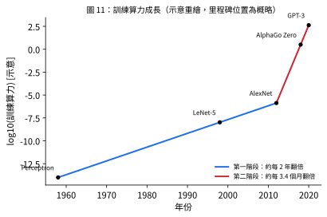

# 規模化與表徵學習 (Scaling and Representation Learning)

## 1. 規模 (Scale)

📌講義：深度學習起源的重要主題是神經網路規模（以參數數量衡量）的顯著增加：1980 年代常見的網路只有數百或數千個參數，之後穩定上升到百萬、十億，當前最先進模型可達約 $10^{12}$（一兆）個參數。參數眾多的網路需要相應龐大的資料集，巨型模型與巨型資料集的結合又需要巨量訓練計算。(來源: [[ch01-deep-learning-revolution]], p.15)

📌講義：原為電玩圖形快速渲染而開發的**圖形處理器 (GPU)** 非常適合訓練神經網路，因為同一層各單元所計算的函數可以平行求值，正好對應 GPU 的大規模平行架構（Krizhevsky, Sutskever, and Hinton, 2012）。今天最大模型的訓練在數千顆 GPU 以專用高速互連組成的陣列上進行。(來源: [[ch01-deep-learning-revolution]], p.15)

## 2. 算力成長

📌講義：圖 11 說明訓練最先進神經網路所需計算量如何隨年代成長，呈現兩階段：縱軸為指數尺度，單位 petaflop/s-day（一個 petaflop 為 $10^{15}$ 次浮點運算；一個 petaflop/s-day 約 $10^{20}$ 次浮點運算）。從感知器時代到約 2012 年翻倍時間約 2 年，與摩爾定律一致；2012 年起（深度學習時代）翻倍時間縮短為 **3.4 個月**，相當於每年算力增加約 **10 倍**。講義原圖來自 OpenAI。(來源: [[ch01-deep-learning-revolution]], p.15)



> [!warning] 差異：圖 11 的縱軸刻度與正文數值不一致（講義內部）
> - 圖 11 的縱軸刻度標示為 $10^{-14}$ 至 $10^{2}$（petaflop/s-days，示意）。(來源: [[ch01-deep-learning-revolution]], p.15)
> - 正文寫「圖上最高處代表驚人的 $10^{24}$ 次浮點運算」。(來源: [[ch01-deep-learning-revolution]], p.15)
> - 而 1 petaflop/s-day ≈ $10^{20}$ 次運算，故 $10^{24}$ 次運算 ≈ $1.2\times10^{4}$ petaflop/s-days；習題 10(c) 也問到此換算。(來源: [[ch01-deep-learning-revolution]], p.18)
>
> 若縱軸頂端為 $10^2$ petaflop/s-day，則對應的是約 $10^{22}$ 次運算而非 $10^{24}$。本 wiki **不自行裁決**哪一個才是講義本意，圖 11 的重繪因此改用不含單位的 log10 軸，並已記入 log。

## 3. 規模化優於精巧設計：《苦澀的教訓》

📌講義：人們經常發現，架構創新或更精巧的歸納偏差所帶來的效能改進，很快就被單純擴大訓練資料量（連同模型規模與訓練算力的相應擴大）所超越（Sutton, 2019，即《苦澀的教訓》The Bitter Lesson）。大模型不僅在特定任務表現更佳，同一個訓練好的網路還可能解決更廣泛的問題；LLM 是顯著的例子：單一網路能力極廣，甚至勝過為特定問題設計的專門網路（講義指向 §12.3.5）。(來源: [[ch01-deep-learning-revolution]], p.15)

## 4. 表徵學習與基礎模型

📌講義：**表徵學習 (representation learning)**（Bengio, Courville, and Vincent, 2012）：網路學習把輸入資料轉換成語意上有意義的新表徵，使最後一層（或幾層）要解的問題容易得多。這些內部表徵可重新利用於相關問題，即**遷移學習**（[[transfer-learning]]）。處理影像的神經網路所學得的內部表徵，與哺乳動物視覺皮質中觀察到的表徵驚人地相似（講義指向 §10.3）。可針對一系列下游任務調適或微調的大型神經網路稱**基礎模型 (foundation models)**（Bommasani et al., 2021）。(來源: [[ch01-deep-learning-revolution]], p.15)

## 5. 其他關鍵進展

📌講義：
- **殘差連結 (residual connections)**（He et al., 2015a）：簡單網路中訓練訊號向後傳播經過深層時逐漸變弱（梯度消失），殘差連結使數百層網路也能訓練。
- **自動微分 (automatic differentiation)**：執行反向傳播計算梯度的程式碼可由指定前向傳播的程式碼自動產生，讓研究者能快速嘗試不同架構，只需明確撰寫相對簡單的前向函數。
- **開源**：機器學習研究多以開源方式進行，加速了領域進展。

(來源: [[ch01-deep-learning-revolution]], p.16)　（講義引用 §9.5 殘差連結：講義引用原書 Ch. 9，未必對應本講義 Ch9，未提供。）

📌講義（講義教學補充）：規模化帶來能力，也帶來**黑盒子**問題：$10^{12}$ 參數的模型很難讓人理解「為何」做出某個預測。這是符號迴歸與可解釋 AI 的動機——尋找像 §1.2 那樣「參數少、形式明確」卻仍能泛化的模型。在實際應用（如電離層 VTEC 建模）中，可解釋的簡潔公式與高容量黑盒模型之間該如何取捨，是值得思考的問題。(來源: [[ch01-deep-learning-revolution]], p.16)

## 6. 習題 10 解答（對應：第一章習題 10）

📌講義：習題 10（⋆算力成長的算術）：(a) 若翻倍時間為 3.4 個月，計算一年內成長倍數，驗證「每年約 10 倍」；(b) 若翻倍時間為 2 年，從 1958 到 2012 共成長多少倍？(c) 一個 petaflop/s-day 約為多少次浮點運算？在圖 11 的尺度下，$10^{24}$ 次浮點運算對應多少 petaflop/s-days？(d) 某 GPU 持續輸出 $10^{15}$ flop/s，訓練需 $10^{24}$ 次運算，用 1,000 顆 GPU 需要多少天？(來源: [[ch01-deep-learning-revolution]], p.18)

**以下解答皆為 💡補充：**

**(a)** 一年 12 個月含 $12/3.4\approx3.53$ 次翻倍，成長倍數 $2^{12/3.4}\approx11.5$，與「每年約 10 倍」同一數量級（若恰為 10 倍／年，翻倍時間為 $12\log_{10}2\approx3.61$ 個月，所以講義的 3.4 個月與「每年約 10 倍」是取整後的說法。）

**(b)** 1958→2012 共 54 年，翻倍 $54/2=27$ 次，成長 $2^{27}\approx1.34\times10^8$（約 $10^8$ 倍）。

**(c)** 1 petaflop/s-day $=10^{15}\ \text{flop/s}\times86{,}400\ \text{s}=8.64\times10^{19}\approx10^{20}$ 次浮點運算。$10^{24}$ 次運算 $=10^{24}/(8.64\times10^{19})\approx1.16\times10^{4}\approx10^4$ petaflop/s-days（見第 2 節的差異提示：這個數值已超出圖 11 縱軸標示的上限 $10^2$）。

**(d)** 1,000 顆 GPU 的總速率 $=10^{3}\times10^{15}=10^{18}$ flop/s；所需時間 $=10^{24}/10^{18}=10^{6}$ 秒 $\approx11.6$ 天（假設 100% 利用率；實際利用率低於此，天數更長）。

```python
import numpy as np

# (a) 翻倍時間 3.4 個月 -> 一年成長倍數
print("(a) 2**(12/3.4) =", round(2 ** (12 / 3.4), 2))
print("    若恰為 10 倍/年，翻倍時間 =", round(12 * np.log10(2) / np.log10(10), 3), "個月")

# (b) 翻倍時間 2 年，1958 -> 2012
print("(b) 2**((2012-1958)/2) = %.3e" % 2 ** ((2012 - 1958) / 2))

# (c) petaflop/s-day 與 1e24 flop
pfs_day = 1e15 * 24 * 3600
print("(c) 1 petaflop/s-day = %.3e flop；1e24 flop = %.3e petaflop/s-days" % (pfs_day, 1e24 / pfs_day))

# (d) 1000 顆 GPU，每顆 1e15 flop/s，總需 1e24 flop
seconds = 1e24 / (1000 * 1e15)
print("(d) %.1e 秒 = %.1f 天" % (seconds, seconds / 86400))

# 兩個階段在 2012 -> 2020 的成長差異
print("2012->2020：翻倍 3.4 月 -> x%.2e；翻倍 2 年 -> x%.1f" % (2 ** (8 * 12 / 3.4), 2 ** (8 / 2)))
```

## 自我測驗 Q&A

> [!question] Q1. 2012 年前後，訓練算力的翻倍時間分別是多少？
> [!answer]- 答案
> 2012 年前約 2 年（與摩爾定律一致），2012 年起約 3.4 個月（每年約 10 倍）。(來源: [[ch01-deep-learning-revolution]], p.15)

> [!question] Q2. 為什麼 GPU 適合訓練神經網路？
> [!answer]- 答案
> 同一層各單元的運算彼此獨立，可平行求值，正好對應 GPU 的大規模平行架構。(來源: [[ch01-deep-learning-revolution]], p.15)

> [!question] Q3. 什麼是表徵學習？它與遷移學習、基礎模型的關係？
> [!answer]- 答案
> 網路把輸入轉換為語意上有意義的內部表徵，讓末端任務更容易；這些表徵可重複用於相關問題（遷移學習），可微調到多種下游任務的大型網路稱基礎模型。(來源: [[ch01-deep-learning-revolution]], p.15)

> [!question] Q4. 殘差連結與自動微分各解決什麼問題？
> [!answer]- 答案
> 殘差連結緩解深層網路中訓練訊號逐層變弱（梯度消失），使數百層網路可訓練；自動微分由前向程式碼自動產生反向傳播程式碼，讓研究者能快速嘗試不同架構。(來源: [[ch01-deep-learning-revolution]], p.16)

> [!question] Q5. 用 1,000 顆 $10^{15}$ flop/s 的 GPU 訓練需要 $10^{24}$ 次運算的模型，理論上要幾天？
> [!answer]- 答案
> 💡補充：$10^{24}/(10^{3}\times10^{15})=10^{6}$ 秒 $\approx11.6$ 天（100% 利用率下）。

## 相關頁面

[[history-of-neural-networks]] · [[three-eras-of-neural-networks]] · [[transfer-learning]] · [[generalization-overfitting]] · [[learning-paradigms]]
